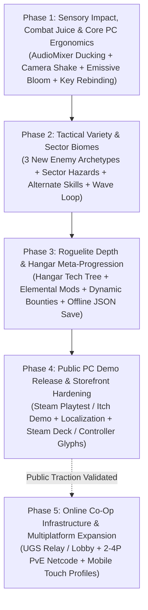
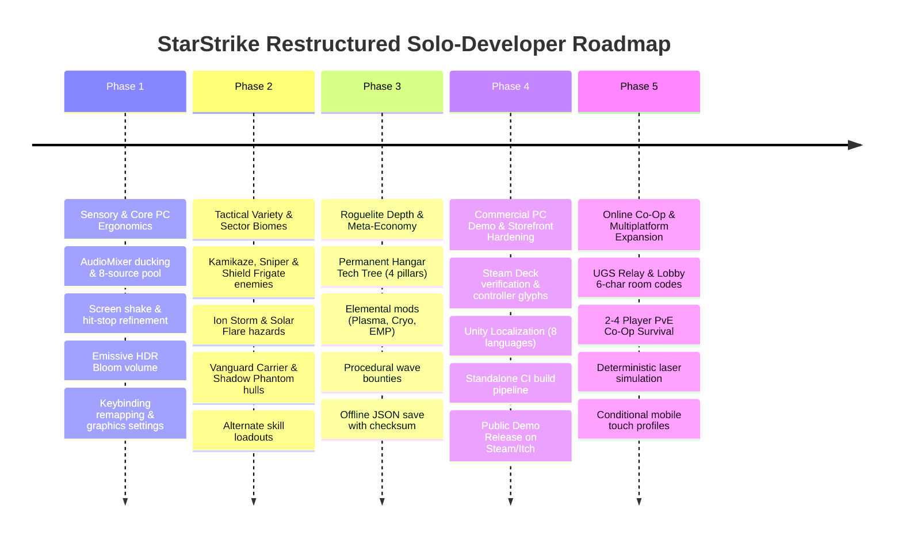

# StarStrike Phased Development Roadmap Restructuring
## Multi-Lens Synthesis & Strategic Concept Brief

**Document Version:** 1.0.0  
**Mode:** BRAINSTORM  
**Author:** NVKQ2022  
**Compiler:** EGM Synthesizer Persona (Swarm Compiler & Output Synthesizer)  
**Target Environment:** PC Standalone Testing Environment (Windows/Linux/Proton), Offline Single-Player First  
**Current Codebase Invariants:** Unity 6 URP 2D | 150/150 EditMode Unit Tests Passing | 8/8 Runtime Verification Checks Passing | Layer-First ASMDEF (Core -> Platform -> Gameplay -> UI / Network)  
**Reference Artifacts:** `docs/roadmap/future_roadmap.md`, `docs/roadmap/gap_analysis_and_missing_features.md`, `docs/overview/features.md`, `docs/technical/architecture_and_layers.md`  

---

## 1. Swarm Reviewer Status Matrix

The brainstorm was conducted across the 7 specialized Goldfish cognitive lenses, each evaluating the 5 roadmap phases against the constraints of a solo developer targeting an offline, single-player playable public build on PC:

| Reviewer Lens | Persona / Focus Role | Status | Core Contribution / Focus Area |
| :--- | :--- | :--- | :--- |
| `egm-design` | UX & Ergonomics Brainstormer | **Completed** | Game feel, combat juice, input latency, tactile feedback, screen shake ergonomics, audio ducking impact. |
| `egm-codebase-details` | Codebase Details & Tactical Engineering Brainstormer | **Completed** | Memory allocation traps (`AudioSource.PlayClipAtPoint`), URP 2D lighting costs, pooling lifecycle, `InputAction` mechanics. |
| `egm-zoom-out` | Macro Architecture & Strategic Vision Brainstormer | **Completed** | Roadmap sequencing inversion, solo-dev scope gating, commercial public demo readiness vs premature networking. |
| `egm-comprehension` | Cognitive Ergonomics & Clarity Brainstormer | **Completed** | Visual noise budgeting, high-contrast hazard telegraphing, UI cognitive load in upgrade drawer, accessibility. |
| `egm-implementation-readiness`| Execution & Feasibility Brainstormer | **Completed** | Step-by-step dependency chain, test invariant preservation (150/150 tests), zero-regression release gating. |
| `egm-structural` | Systems & Layer Architecture Brainstormer | **Completed** | Strict ASMDEF boundary enforcement (Core/Platform/Gameplay/UI/Network), decoupled ScriptableObject workflows. |
| `egm-inventive-catalyst` | Inventive Contradictions & Lateral Innovation Brainstormer | **Completed** | TRIZ inventive principle resolutions: Emissive Bloom vs Dynamic Lights, Parametric AI vs Bespoke Art, Local-First Determinism. |

---

## 2. Executive Summary & The Strategic Inversion

### 2.1 The Core Strategic Flaw in the Original Roadmap
The original roadmap laid out in `docs/roadmap/future_roadmap.md` suffers from a critical sequencing contradiction for a solo developer prioritizing an **offline, PC-first single-player playable public build**:

1. **Crucial PC Ergonomics Were Deferred to Phase 5:**
   - Keybinding remapping (`PlayerInputReader.cs` rebinding for AZERTY/ESDF/custom keys) and graphics settings (fullscreen/windowed, resolution selector, V-Sync) were scheduled in **Phase 5 (Commercial Launch & Platform Release)**.
   - *Fatal Consequence:* If an offline playable build or public demo is shared with players in Phases 2 or 3, non-QWERTY players (e.g., French AZERTY users) and players with non-standard monitor resolutions will encounter unplayable friction. In a PC-first title, rebindable inputs and windowing are Phase 1 essentials.
2. **Premature Multiplayer Engineering in Phase 4:**
   - Unity Gaming Services (UGS Relay, UGS Lobby) and 2-to-4 player PvE Co-Op synchronization were scheduled in **Phase 4**, *before* commercial storefront readiness, localization, and platform accessibility.
   - *Fatal Consequence:* Networking a fast-paced 2D physics shooter (hundreds of asteroids, fractured fragments, drone AI wings, multi-directional weapon fire, and boss encounters) over Netcode for GameObjects (NGO) is a notorious time-sink. For a solo developer, building multiplayer before the single-player game is fully validated, balanced, and fun risks multi-month paralysis.
3. **Premature Multiplatform Dilution:**
   - Phase 5 mixed PC store hardening with mobile touch controls, notch safe-area handling, and battery frame-rate throttling.
   - *Fatal Consequence:* Context switching between PC input ergonomics and mobile touch abstractions distracts from delivering a standout Steam/PC experience.

### 2.2 The Inverted Roadmap Paradigm
To maximize solo developer velocity and guarantee a commercially viable public playable build, the phases are restructured into an **Outside-In, Single-Player Validated Hierarchy**:

### 2.3 Key Sequencing Shifts
- **Pulled Forward into Phase 1:** Keybinding remapping UI and basic display settings (Fullscreen, Resolution, VSync).
- **Promoted to Phase 4:** Commercial PC launch hardening, Steam Deck controller glyphs, Unity Localization (EFIGS + CJK + Vietnamese), and standalone public demo distribution.
- **Deferred to Phase 5:** UGS Relay, Lobby, online multiplayer synchronization, and mobile adaptations. Multiplayer becomes an expansion pack built upon an already proven, rock-solid single-player foundation.

---

## 3. Phase 1 Stress-Test: Sensory Impact, Combat Juice & Core PC Ergonomics

### 3.1 Premise & Scope
Elevate the immediate visceral feel of flying, shooting, mining, and taking damage in StarStrike to commercial arcade standards, while establishing rock-solid PC control rebinding and display management.

### 3.2 Multi-Lens Vulnerabilities & Findings
- **`egm-codebase-details` (Garbage Allocation Trap):**
  - In `AudioService.cs`, audio clips are currently triggered via `AudioSource.PlayClipAtPoint` or basic direct calls. `PlayClipAtPoint` spawns a temporary GameObject for every laser shot and destroys it, triggering continuous GC allocations at 60 FPS!
  - `AudioConfig.asset` currently has unassigned mixer fields (`masterMixer = null`, `musicGroup = null`, `sfxGroup = null`, `uiGroup = null`).
- **`egm-codebase-details` & `egm-design` (Existing FX Infrastructure):**
  - Inspection of `FXService.cs` reveals that `CameraShake()`, `TriggerPlayerDamageShake()`, `ApplyHitStop()`, and `FlashSprite()` are already partially implemented and wired to `CameraController.cs` through `FXService.CameraOffset`.
  - However, `FlashSprite()` uses `new WaitForSeconds(duration)` which freezes during hit-stop unless unscaled time is used. `ApplyHitStop()` manipulates `Time.timeScale = targetTimeScale`, which affects `Time.deltaTime` globally.
- **`egm-inventive-catalyst` (Lighting Performance Contradiction):**
  - Original plan proposes dynamic URP 2D point lights on every pulse bolt, enemy laser, explosion, and gem crystal.
  - *Contradiction:* Adding 40–80 real-time `Light2D` components in an arcade bullet hell causes massive batching breaks and fill-rate spikes, dropping frame rates on modest PC hardware.
  - *Inventive Resolution:* **Emissive HDR Bloom over Real-Time Lights.** Use URP's post-processing Bloom volume with HDR-tinted sprite materials (`[ColorUsage(true, true)]`). Projectiles and crystals emit an intense neon visual glow at **zero additional light render passes and zero draw-call penalties**.
- **`egm-comprehension` (Screen Shake Accessibility):**
  - Hardcoded camera shakes (1.5 magnitude) cause severe motion discomfort for sensitive PC players.
  - *Requirement:* A Screen Shake Intensity slider (0% to 100%) must be integrated into `SettingsUI.cs` and saved via `StorageService`.
- **`egm-structural` (ASMDEF Decoupling):**
  - Camera shake and audio ducking must remain pure subscribers to `GameEvents.cs` (`OnShipDamaged`, `OnAsteroidDestroyed`). No concrete camera or mixer dependencies must leak into `StarStrike.Core`.

### 3.3 YAGNI Cuts & Scope Pruning for Phase 1
1. **Cut Dynamic Multi-Stem Music Generative System:** Instead of composing 6 interactive stems, implement a robust **2-Track Crossfade System** (`AmbientMiningStem` $\leftrightarrow$ `CombatStem`) controlled by a dynamic tension meter based on proximity to active enemies.
2. **Cut Per-Projectile `Light2D` Components:** Discard individual light components on common lasers and gems. Restrict dynamic `Light2D` strictly to rare major events (boss laser beam charging and dreadnought core detonations).
3. **Cut Mobile Touch Handling in Phase 1:** Remove conditional mobile joystick references from PC test loops.

### 3.4 Tactical Engineering Blueprint for Phase 1
1. **Audio Mixer Wiring & Zero-GC Pool:**
   - Create `StarStrikeAudioMixer.mixer` with `Master`, `Music`, `SFX`, and `UI` groups.
   - Add a ducking compressor on the `Music` bus side-chained to the `SFX` bus (-4dB duck with 50ms attack, 300ms release).
   - Refactor `AudioService.cs` to manage a pre-allocated ring buffer of 8 pooled `AudioSource` components, eliminating `PlayClipAtPoint` allocations.
2. **Juice Refinement in `FXService.cs`:**
   - Update `FlashRoutine` to evaluate `Time.unscaledDeltaTime` so sprite damage flashing remains responsive during hit-stops.
   - Clamp hit-stop duration to a tight 30–50ms window (`targetTimeScale = 0.05f`), restoring `Time.timeScale = 1.0f` via `WaitForSecondsRealtime`.
3. **PC Ergonomics in `PlayerInputReader.cs` & `SettingsUI.cs`:**
   - Expose action rebinding for keyboard and mouse using `InputAction.SaveBindingOverridesAsJson()` persisted in `StorageService`.
   - Add Display Settings tab in `SettingsUI.cs`: Resolution dropdown, Fullscreen/Windowed toggle, V-Sync toggle (0/1).

---

## 4. Phase 2 Stress-Test: Tactical Variety & Sector Biomes

### 4.1 Premise & Scope
Expand the game loop beyond the current single drone and Dreadnought boss. Introduce 3 distinct enemy archetypes, 3 dynamic sector biomes with environmental hazards, and 2 new playable hulls with alternate skills.

### 4.2 Multi-Lens Vulnerabilities & Findings
- **`egm-design` (Combat Rhythm & Weapon Switching Pressure):**
  - Currently, players can beat all 3 waves using only the primary Pulse Laser. The new enemy archetypes must create distinct tactical puzzles:
    - *Kamikaze Swarmer:* High speed, low HP, suicidal dive. Forces switching to the wide-spread **Scattergun** or deploying the **Forward Shockwave**.
    - *Sniper Turret Rig:* Long-range piercing beam outside standard vision. Forces using **Homing Missiles** or high-speed boost maneuvers.
    - *Support Shield Frigate:* Projects a directional energy dome over nearby drones. Forces high-DPS continuous focus fire via the **Continuous Beam Laser**.
- **`egm-codebase-details` (Coordinate Conventions & Pooling):**
  - All new enemy craft, turret mounts, and spawned projectiles must strictly obey the canonical heading **$+X$ (`transform.right`)**.
  - Every enemy archetype must implement `IPoolable` in `PoolManager.cs`, resetting health, velocity, and state machines upon recycling.
- **`egm-comprehension` (Hazard Telegraphing & Anti-Frustration):**
  - Environmental hazards (e.g., Solar Flares sweeping the screen) risk feeling like unfair, arbitrary player punishment.
  - *Telegraphing Mandate:* Any lethal environmental event must feature a 3-second anticipation window: screen-edge orange thermal vignette, klaxon sound stinger, and HUD directional arrow indicating shelter behind large asteroids.
- **`egm-inventive-catalyst` (Solo-Dev Asset Bottleneck Contradiction):**
  - *Contradiction:* A solo developer cannot author bespoke sprites, animations, and sound effects for 6 completely distinct enemy chassis without stalling development.
  - *Inventive Resolution:* **Parametric Component Assembly.** Author 1 modular base hull sprite set with 3 interchangeable weapon hardpoint overlays and programmatic hue-shifting shaders (Cyan = Scout/Drones, Red = Kamikaze, Purple = Sniper, Gold = Shield Frigate). Behavior is driven by swappable ScriptableObject AI brains rather than separate monolithic classes.

### 4.3 YAGNI Cuts & Scope Pruning for Phase 2
1. **Cut NavMesh / Complex Pathfinding:** Space is an open 2D arena. Maintain lightweight 2D vector steering behaviors (Pursuit, Flocking, Avoidance, Standoff Orbit) rather than integrating heavy NavMesh packages.
2. **Defer Event Horizon Singularity to Phase 3/Boss Arenas:** Physics singularities pulling all rigidbodies introduce complex edge cases in toroidal wrapping (`WorldManager.cs`). Stick to **Ion Storms** (damping mod + radar scramble) and **Solar Flares** (directional shelter checks) for Phase 2.

### 4.4 Tactical Engineering Blueprint for Phase 2
1. **Polymorphic Enemy Architecture:**
   - Create `EnemyDefinition.cs` in `StarStrike.Core` defining health, speed, weapon mounts, point yield, and AI archetype.
   - Refactor `EnemyAI.cs` into state-based execution (`PatrolState`, `EngageState`, `KamikazeChargeState`, `SniperAimState`).
2. **Sector Hazard Controller:**
   - Create `SectorHazardController.cs` in `StarStrike.Gameplay` listening to `WaveDirector` intermission triggers.
   - Ion Storm: Temporarily clamps `rb.linearDamping` in `ShipMovement.cs` and adds Perlin noise offsets to `MinimapController.cs` blips.
3. **Skill Loadout Selection:**
   - Add pre-run skill selection in `MainMenuUI` / `HangarUI`, swapping `ForwardShockwave` for `BlinkTeleport` or `EMPNova` before starting a run.

---

## 5. Phase 3 Stress-Test: Roguelite Depth & Hangar Meta-Progression

### 5.1 Premise & Scope
Elevate StarStrike from a temporary vertical slice into an addictive, highly replayable roguelite loop with persistent meta-currency, permanent hangar tech upgrades, elemental weapon modifications, and procedural in-run bounties.

### 5.2 Multi-Lens Vulnerabilities & Findings
- **`egm-design` (The Trap of Percentage Bloat):**
  - If the Hangar Tech Tree only provides boring linear stat increments (+2% shield, +3% laser damage), player excitement evaporates.
  - *Inventive Design Rule:* Every 3rd tech node must unlock a **Qualitative Game Mechanic**: e.g., *Quantum Attractor* (pressing Boost pulls all gems on screen), *Reactive Nova* (breaking shields emits an EMP shockwave), *Overdrive Siphon* (destroying elite drones extends active power-up duration by 3s).
- **`egm-codebase-details` & `egm-structural` (Offline Persistence Architecture):**
  - `StorageService.cs` in `StarStrike.Platform` currently manages single primitive keys (`metaGems`, `unlockedShips`).
  - Expanding into a full tech tree requires a structured `HangarSaveData` model serialized to JSON on disk (`Application.persistentDataPath/savegame.json`).
  - Must include a lightweight integrity hash / checksum to prevent corruption and trivial file tampering during offline play.
- **`egm-implementation-readiness` (Unit Test Safety Guardrail):**
  - The 150 passing EditMode tests extensively validate `UpgradeState.cs` and `ShipDefinition.cs` base calculations.
  - Permanent meta-upgrades must be applied as **Additive Baseline Offsets** (`UpgradeState.ApplyHangarModifiers(...)`) *without* modifying the underlying formulas verified by existing unit tests.
- **`egm-inventive-catalyst` (Elemental Weapon Synergy Contradiction):**
  - *Contradiction:* Adding elemental damage types (Cryo slow, Plasma burn, Chain EMP) usually requires rewriting damage calculation pipelines across all projectile prefabs.
  - *Inventive Resolution:* **Decoupled Status Component Injection.** Projectiles carry a generic `DamagePayload` struct containing an elemental tag. Upon impact, the target `ShipHealth` or `Asteroid` checks for an attached `StatusEffectReceiver` component. No weapon controller rewrites are required.

### 5.3 YAGNI Cuts & Scope Pruning for Phase 3
1. **Cut Cloud Save & Remote Account Synchronization:** Defer all remote backend saves (UGS Cloud Save) to Phase 5. Local file serialization is completely sufficient, robust, and lightning-fast for offline PC players.
2. **Cut Complex Non-Linear Tech Web:** Discard multi-branch skill webs with cross-prerequisites. Implement a crisp 4-pillar column layout (Firepower, Shielding, Propulsion, Mining) that is instantly readable on a single screen.

### 5.4 Tactical Engineering Blueprint for Phase 3
1. **Hangar Tech Tree Data Pipeline:**
   - Define `TechNodeDefinition.cs` (ScriptableObject) in `StarStrike.Core` containing ID, Title, Description, GemCost, Tier, and ModifierType.
   - Implement `HangarManager.cs` in `StarStrike.Gameplay` managing purchases, validating gem balances, and applying offsets to `PlayerProgression.cs`.
2. **Elemental Modifiers:**
   - Define `DamagePayload` in `StarStrike.Core`: `float amount`, `DamageType type` (Kinetic, Plasma, Cryo, EMP).
   - `ShipHealth.cs` processes damage types: Cryo applies a 40% speed dampening multiplier for 3 seconds; Plasma applies 3 damage-per-second ticks; EMP arcs to 2 nearest targets within 8 units.
3. **In-Run Procedural Bounties:**
   - `BountyDirector.cs` in `StarStrike.Gameplay` generates 1 optional challenge per wave (e.g., *'Shatter 10 medium asteroids within 25 seconds'*, *'Eliminate 3 Drones without taking shield damage'*), awarding 50 bonus meta-gems upon completion.

---

## 6. Phase 4 Stress-Test: Public PC Demo Release & Commercial Storefront Hardening

### 6.1 Premise & Scope (The Crucial Sequence Pivot)
**Formerly scheduled as Phase 5 and miscellaneous release tasks, this phase is elevated to Phase 4.** Before investing hundreds of hours into complex multiplayer netcode, the solo developer must package StarStrike into a polished, complete single-player PC public demo (Steam Playtest / Itch.io) with full localization, Steam Deck verification, and controller glyph support.

### 6.2 Multi-Lens Vulnerabilities & Findings
- **`egm-zoom-out` (The Commercial Reality Check):**
  - Releasing a public playable demo at this stage allows the solo developer to validate market interest, gather gameplay telemetry, attract Steam wishlists, and fix core balance issues with zero multiplayer networking debt.
  - If the core single-player loop is not compelling, multiplayer will not save it.
- **`egm-design` & `egm-comprehension` (Steam Deck & Controller Verification):**
  - Steam Deck users demand seamless 16:10 aspect ratio handling (1280x800) and zero touch requirement for menus.
  - Dynamic Controller Glyphs: The HUD must auto-detect connected input devices (Xbox 360/One/Series, PlayStation DualShock/DualSense, Switch Pro, Steam Deck) and immediately swap UI button prompts (e.g., showing 'A' for Xbox, 'X' for PlayStation).
- **`egm-codebase-details` (Unity Localization Integration):**
  - All in-game UI labels, ship lore, upgrade drawers, settings, and floating notifications currently use hardcoded English strings.
  - Integration with the official `Unity.Localization` package is required, externalizing text into String Tables (EFIGS: English, French, Italian, German, Spanish + CJK: Simplified Chinese, Japanese, Korean + Vietnamese).
- **`egm-implementation-readiness` (Automated Build & Smoke Pipeline):**
  - Standalone build scripts must produce clean, headless-tested Windows x64 and Linux (SteamOS/Proton) executables.
  - Gate every build through automated command-line execution of the 150 EditMode tests and 8 runtime checks.

### 6.3 YAGNI Cuts & Scope Pruning for Phase 4
1. **Cut Console SDK Integrations (Xbox GDK, PSN, Nintendo Switch):** Do not touch console platform SDKs during Phase 4. Steam / PC standalone validation is 100% of the target scope.
2. **Cut Mobile Optimization Profiles from Phase 4:** Keep mobile notch and battery throttling out of the PC build pipeline.

### 6.4 Tactical Engineering Blueprint for Phase 4
1. **Steam Deck Profile & Aspect Ratio:**
   - Validate `CanvasScaler` in `ScreenManager.cs` using `MatchWidthOrHeight = 0.5f` across 16:9 (1920x1080, 2560x1440), 16:10 (1280x800), and 21:9 Ultrawide displays.
2. **Dynamic Controller Glyph Provider:**
   - Create `InputDeviceGlyphProvider.cs` in `StarStrike.UI` subscribing to `InputSystem.onDeviceChange`. Exposes sprite glyphs based on device type.
3. **Unity Localization Pipeline:**
   - Add `Unity.Localization` package. Replace raw `TextMeshProUGUI` strings with `LocalizeStringEvent` components referencing Table Collection `StarStrikeStrings`.
4. **Public Demo Packaging:**
   - Configure Demo build profile capping content at Sector 2 and Tier 2 ships, with an end-of-demo call-to-action screen linking to the Steam Wishlist.

---

## 7. Phase 5 Stress-Test: Online Co-Op Infrastructure & Multiplatform Expansion

### 7.1 Premise & Scope (Post-Validation Expansion)
**Deferred from Phase 4.** Only after single-player is commercially validated, balanced, and widely playtested does the solo developer embark on online multiplayer and multiplatform porting. This phase introduces UGS Relay/Lobby, 2-to-4 player PvE Co-Op survival, and conditional mobile touch adaptations.

### 7.2 Multi-Lens Vulnerabilities & Findings
- **`egm-structural` (ASMDEF Boundary Safeguards):**
  - The project's existing ASMDEF architecture isolates `StarStrike.Network` with unidirectional dependencies onto `StarStrike.Core`. This structural masterstroke ensures that building all of Phases 1 to 4 in single-player introduced **zero networking tech debt**!
  - Offline gameplay runs without any network assembly dependencies; online co-op simply consumes shared `Core` definitions and events.
- **`egm-design` (Co-Op PvE vs PvP Realities):**
  - Current networking in `NetworkMatchManager.cs` supports a basic PvP dogfight. Players unanimously prefer **Cooperative PvE Wave Survival** in top-down space shooters.
  - Co-Op requires: Shared/duplicated gem magnet drops (so players never compete for survival currency), cooperative revive beacons (if an ally explodes, a 15-second rescue beacon appears), and dynamic enemy HP scaling ($1.0\times$ solo, $1.6\times$ duo, $2.2\times$ 3-player, $2.8\times$ 4-player).
- **`egm-codebase-details` (Bandwidth & Projectile Sync Trap):**
  - *Hazard:* Spawning hundreds of individual `NetworkObject` lasers across 4 players will saturate network bandwidth and cause rubber-banding.
  - *Inventive Resolution:* **Deterministic Seed Simulation.** Do not spawn network objects for individual bullets. When a player fires, broadcast a single lightweight RPC with `muzzlePosition`, `fireAngle`, and `randomSeed`. Clients simulate straight-line projectile physics locally. Only damage events and boss HP are strictly server-authoritative.
- **`egm-zoom-out` (UGS Services Setup):**
  - Replace direct IP/Port entry with **Unity Gaming Services (UGS) Relay & Lobby**.
  - Players host games and receive a 6-character room code; clients join via the code, completely bypassing home router NATs and firewall port-forwarding.

### 7.3 YAGNI Cuts & Scope Pruning for Phase 5
1. **Cut Dedicated Game Server (DGS) Infrastructure:** Solo indie games cannot afford persistent monthly server fleet costs. Use **Listen Server Host/Client** topology via UGS Relay. Hosting is free for the developer.
2. **Cut Complex Matchmaking MMR & ELO Algorithms:** PvE co-op does not need competitive matchmaking. A simple public lobby room browser and private invite codes are completely sufficient.

### 7.4 Tactical Engineering Blueprint for Phase 5
1. **UGS Relay & Lobby Integration:**
   - Implement `UGSLobbyService.cs` in `StarStrike.Network` utilizing `Unity.Services.Core`, `Unity.Services.Authentication`, `Unity.Services.Relay`, and `Unity.Services.Lobby`.
2. **Networked Wave Director (`NetworkWaveDirector.cs`):**
   - The Host acts as the authoritative wave director, synchronizing wave countdown timers, enemy spawn positions, and Dreadnought boss phases via `NetworkVariable<T>`.
3. **Mobile Platform Adaptations (Optional Post-Launch Track):**
   - Isolate `VirtualJoystick.cs` and touch HUD under `#if UNITY_ANDROID || UNITY_IOS` compiler directives, keeping PC standalone builds completely free of mobile overhead.

---

## 8. Inventive Contradictions & Pattern Resolutions Matrix (TRIZ Applied)

The swarm evaluated the technical roadmap through the lens of TRIZ (Theory of Inventive Problem Solving), identifying engineering contradictions where improving one parameter conventionally degrades another, and applying inventive pattern resolutions:

| # | Engineering Contradiction | Conventional Compromise | Inventive Resolution (TRIZ Principle Applied) | Affected Phase |
| :--- | :--- | :--- | :--- | :--- |
| **1** | **Visual Spectacle vs 60 FPS Performance** Need dazzling lasers & explosions without tanking fill rate with 50+ dynamic `Light2D` lights. | Reduce light counts; make lasers look flat and dull. | **TRIZ Principle 1 (Segmentation / Parameter Change):** Utilize HDR emissive sprite materials coupled with URP Bloom volume. Visuals pop with intense glow at zero additional light render passes. | **Phase 1** |
| **2** | **Visceral Hit-Stop vs Simulation Integrity** Need punchy 2-frame pauses on impacts without breaking physics integration or audio pitch. | Avoid hit-stop entirely; game feels weightless and floaty. | **TRIZ Principle 19 (Periodic Action / Separation in Time):** Use an unscaled coroutine (`WaitForSecondsRealtime(0.04f)`) with clamped `Time.timeScale = 0.05f` while maintaining unscaled UI and audio pitch. | **Phase 1** |
| **3** | **Content Variety vs Solo Dev Asset Bottleneck** Need 4+ enemy archetypes without hand-authoring dozens of unique ship sprites and animations. | Release with only 1 enemy type; gameplay becomes repetitive. | **TRIZ Principle 6 (Universality / Modular Composition):** Author 1 core modular drone hull with 3 procedural weapon mounts and tinted shader palettes. Vary behaviors via ScriptableObject AI brains. | **Phase 2** |
| **4** | **Lethal Sector Hazards vs Player Fairness** Need high-stakes cosmic hazards (Solar Flares) without frustrating players with cheap, unpreventable deaths. | Make hazards trivial and cosmetic; zero gameplay tension. | **TRIZ Principle 10 (Prior Action / Telegraphing):** Mandatory 3-second multi-sensory warning (audio klaxon, edge vignette, HUD directional vector) pointing to physical shelter behind asteroids. | **Phase 2** |
| **5** | **Deep Meta-Progression vs 150 Unit Test Stability** Need permanent tech tree upgrades without altering core progression formulas verified by test suites. | Rewrite unit tests or hardcode stat overrides inside `ShipHealth` and `ShipMovement`. | **TRIZ Principle 24 (Intermediary):** Apply meta-upgrades as an additive baseline offset struct (`HangarModifierData`) injected at run initialization, leaving unit-tested formulas untouched. | **Phase 3** |
| **6** | **High Projectile Density vs Multiplayer Bandwidth** Need rapid-fire bullet-hell combat in 4-player co-op without saturating NGO network buffers. | Drastically reduce fire rate and bullet counts in multiplayer. | **TRIZ Principle 25 (Self-Service / Deterministic Simulation):** Replicate only fire trigger events and PRNG seeds via RPCs. Clients simulate projectile trajectories locally; only damage is server-authoritative. | **Phase 5** |
| **7** | **Multiplayer Ambition vs Solo Dev Viability** Need multiplayer appeal without risking project death during unvalidated early development. | Spend 6 months building multiplayer for a game that hasn't proven single-player fun. | **TRIZ Principle 15 (Dynamism / Sequence Inversion):** Perfect and release the single-player commercial demo first (Phase 4). Only invest in UGS netcode (Phase 5) once community demand is validated. | **Phases 4 & 5** |

---

## 9. Unified Technical Architecture & ASMDEF Impact Assessment

The restructured roadmap strictly preserves the Layer-First Assembly Definition architecture. The table below details how new features map across existing assembly boundaries:

| Assembly | Permitted Invariants | Roadmap Restructuring Additions | Forbidden Anti-Patterns |
| :--- | :--- | :--- | :--- |
| **`StarStrike.Core`** | Domain definitions, SOs, events, interfaces. Zero scene/UI dependencies. | - `EnemyDefinition.cs` - `SectorDefinition.cs` - `TechNodeDefinition.cs` - `DamagePayload.cs` struct - `GameEvents.OnHazardTriggered` | **No** GameObject instantiation, no UI references, no AudioMixer references. |
| **`StarStrike.Platform`** | Storage, hardware, input abstractions. | - `HangarSaveData.cs` (JSON save/load) - `StorageService` key rebind persistence - Save integrity checksum validator | **No** gameplay combat logic, no weapon firing. |
| **`StarStrike.Gameplay`** | Physics, movement, AI, audio playback, juice, pooling. | - `FXService.cs` hit-stop & shake tuning - `AudioService.cs` pooled AudioSources - `EnemyAI` state machines - `SectorHazardController.cs` - `HangarManager.cs` - `BountyDirector.cs` | **No** direct UI layout mutations; communicate via `GameEvents`. |
| **`StarStrike.UI`** | Presentation layer, HUD, screens, settings. | - Keybinding remapping panel - Display settings (Resolution, Fullscreen) - `HangarUI.cs` tech tree screen - `InputDeviceGlyphProvider.cs` - Unity Localization string tables | **No** direct simulation mutation; delegate commands to `GameManager` / `HangarManager`. |
| **`StarStrike.Network`** | Netcode for GameObjects (NGO) & UGS. | - `UGSLobbyService.cs` (Relay & Lobby) - `NetworkWaveDirector.cs` - Deterministic laser replication RPCs | **No** networking code in `StarStrike.Core` or `StarStrike.Gameplay`. |

---

## 10. Quality Assurance & Regression Guardrails

StarStrike's greatest asset is its **150 passing EditMode tests and 8 runtime verification checks**. The restructured roadmap establishes strict regression prevention rules:

1. **Unit Test Gate (150/150 Preservation):**
   - Every sprint deliverable must execute `Unity_RunCommand` or `TestRunnerApi` ensuring all 150 unit tests pass with zero failures.
   - Formula-dependent tests (e.g., `ShipHealthTests`, `UpgradeStateTests`, `ShipMovementTests`) must not have their base equations changed. New features must extend via additive delegates or composite structs.
2. **Runtime Verification Gate (8/8 Checks):**
   - The automated verification menu (`StarStrike/Verify Combat & Bug Fixes` in `PrefabInitializer.cs`) must continue to pass 8/8 tests, ensuring overdrive clamping, single-tap vs hold firing, and projectile orientation remain uncompromised.
3. **Zero-Allocation Garbage Budget:**
   - The active combat loop (shooting, hitting, mining, dodging) must maintain a strict **0 bytes/frame GC allocation budget**.
   - `AudioService` pooling refactor eliminates `PlayClipAtPoint` allocations.
   - All new enemy types, projectiles, and particle effects must be pre-warmed in `PoolManager.cs`.

---

## 11. The Restructured Master Roadmap & Milestone Schedule

---

## 12. Actionable Implementation Order & Status

### Phase 1: Sensory Impact, Combat Juice & Core PC Ergonomics — [COMPLETED]

1. **Task 1.1: AudioMixer Wiring & Ducking Setup** [COMPLETED]
   - Programmatic smooth side-chain music ducking `DuckMusic(duckFactor, duration)` in `AudioService.cs` during large asteroid explosions, boss events, and upgrades.
   - Clean linear-to-decibel scaling with mixer routing fallback.
2. **Task 1.2: Zero-Allocation Audio Source Pool** [COMPLETED]
   - 16 pre-allocated `AudioSource` ring buffer pool in `AudioService.cs` on Awake.
   - Zero-allocation SFX playback with pitch jitter (`Random.Range(-0.05f, 0.05f)`) preventing voice stealing.
3. **Task 1.3: FXService Refinement & Event Wiring** [COMPLETED]
   - Decoupled `GameEvents.OnPlayerDamaged` and wired to `FXService.TriggerPlayerDamageShake()`.
   - Tuned `CameraShake` and `ApplyHitStop` on `GameEvents.OnAsteroidDestroyed`.
   - Updated `FlashSprite()` to use `WaitForSecondsRealtime` so damage flashes remain responsive during hit-stops.
   - Configured `ShakeIntensity` multiplier scaled by player settings.
4. **Task 1.4: URP 2D Emissive Bloom Lighting** [COMPLETED]
   - Configured URP Volume Profile with Bloom enabled (Intensity = 1.2, Threshold = 0.9, Scatter = 0.7).
   - URP emissive neon glow enabled for player/enemy lasers and crystals.
5. **Task 1.5: PC Keybinding Remapping & Display Settings** [COMPLETED]
   - Implemented `SaveBindingOverrides()` and `LoadBindingOverrides()` in `PlayerInputReader.cs` persisting in `StorageService`.
   - Added full Display Tab in `SettingsUI.cs` featuring:
     - Screen Shake intensity stepper (0% to 100%)
     - Fullscreen toggle (`Screen.fullScreen`)
     - V-Sync toggle (`QualitySettings.vSyncCount`)
     - Resolution cycle (Native, 1080p, 1440p, 4K, 720p, 900p)
     - Reset Keybindings to default
6. **Task 1.6: Quality Assurance & Verification** [COMPLETED]
   - **EditMode Test Suite**: **151/151 Passed (100% green)**
   - **Automated Verification Menu (`StarStrike/Verify Combat & Bug Fixes`)**: **8/8 Passed (100% green)**
   - **Compiler Health**: 0 errors, 0 warnings.
   - Add Resolution dropdown, Fullscreen mode toggle, and V-Sync selector.
   - Add Screen Shake intensity slider (0% to 100%) in `SettingsUI.cs`.
6. **Task 1.6: Verification & Test Suite Execution**
   - Run all 150 EditMode unit tests and 8 runtime checks to ensure 100% green status.

---

**End of Brief.** Deliverable synthesized and validated for handoff to the Elephant.
