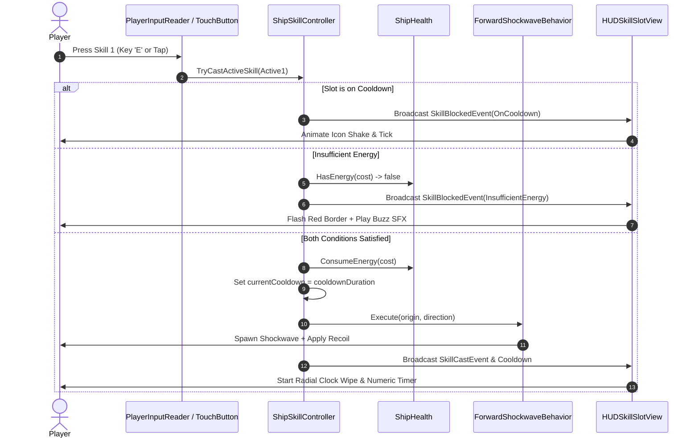

# Ship Combat Skill System

* **Author:** NVKQ2022
* **Date:** 2026-11-14
* **Status:** Draft
* **Target Milestone:** Single-Player Combat Slice

## The Problem

StarStrike's ship combat currently consists of two player actions: firing a primary pulse laser and activating an engine boost. Both actions draw from a shared energy pool. In practice, this creates a repetitive, two-dimensional combat loop characterized by:

1. **Attrition-Based Stat Checks**: Fights against enemy drones and bosses resolve almost entirely through raw damage-per-second versus health pools, rather than tactical timing, positioning, or ability usage.
2. **Absence of Burst and Defensive Counterplay**: When surrounded by multiple hostiles or incoming asteroid clusters, the player has no active mechanisms to clear projectile lanes, break crowd pressure, or absorb spike damage.
3. **Flat Player Expression**: Every ship chassis plays essentially the same in combat, differing only in scalar stats (speed, damage, fire rate) rather than distinctive active ability kits or reactive passive playstyles.

Without active and passive skills, combat encounters lack the high-leverage decision windows and mastery curves expected in arcade space shooters and MOBA-style combat systems.

## Overview

This feature introduces a modular ship skill framework that equips ships with active and passive abilities. For the initial single-player vertical slice, each ship is configured with:

- **1 Active Combat Skill**: An instantaneous ability executed along the ship's forward nose heading without complex trajectory dragging or reticle aiming. It is dual-gated: requiring both cooldown readiness and sufficient ship energy.
- **1 Reactive Passive Skill**: An event-driven ability that activates automatically upon specific combat conditions (such as low shields or consecutive hits), providing defensive resets or offensive power spikes without manual input.

The system is built on an extensible slot-based architecture using Unity ScriptableObjects. While the first iteration activates one active slot and one passive slot, the underlying data structures, event interfaces, and controller components support expanding to four active abilities and multiple passives as the game scales toward full MOBA ship archetypes and multiplayer synchronization.

## Goals

- **Provide Tactical Combat Variety**: Introduce active burst and defensive tools that allow players to reverse disadvantageous combat situations through well-timed ability execution.
- **Maintain Newtonian Flight Ergonomics**: Keep skill execution frictionless during high-speed inertia flight by casting forward along ship heading, avoiding pause-and-aim reticles that break momentum.
- **Implement Dual-Gated Resource Mechanics**: Require both cooldown expiration and a minimum energy cost to fire active skills, reinforcing deliberate resource management between weapons, boost, and abilities.
- **Deliver Clear Sensory Feedback**: Provide distinct visual and acoustic indicators on the HUD that unambiguously differentiate between cooldown lockout and energy starvation.
- **Architect for Zero-Refactor Scalability**: Use an indexed slot container (`SkillSlot[]`) and strategy behaviors (`ISkillBehavior`) that can scale to 4-ability kits and Netcode multiplayer without structural rewrites.

## Non-Goals

- **Netcode Multiplayer Synchronization**: Real-time network RPCs (`ServerRpc` / `ClientRpc`) for multiplayer matches are explicitly out of scope for this slice; network serialization will be layered on in a subsequent milestone.
- **Manual Drag-to-Aim Reticles**: Trajectory prediction cones, area-of-effect targeting circles, and touch drag-to-aim controls are excluded from this release.
- **In-Run Ability Upgrades / Skill Trees**: Skills are assigned per ship definition; spending XP or currency to modify ability parameters mid-run is deferred.
- **Multi-Skill Full MOBA Kits**: Shipping multiple active abilities per ship simultaneously is deferred until the single-active and single-passive balance loop is validated.

## Technical Plan

### System Architecture & Assembly Layering

The skill system strictly adheres to the established assembly boundaries (`StarStrike.Core` -> `StarStrike.Platform` -> `StarStrike.Gameplay` -> `StarStrike.UI`).

```mermaid
flowchart TD
    subgraph Input & UI Layer
        PIR[PlayerInputReader]
        HUD[HUDSkillSlotView]
        TB[TouchButton / Mobile UI]
    end

    subgraph Gameplay Layer
        SSC[ShipSkillController]
        SH[ShipHealth - Energy & Shields]
        SM[ShipMovement - Physics Recoil]
        ACT[ForwardShockwaveBehavior]
        PAS[ReactiveBarrierPassiveBehavior]
        FX[FXService & AudioService]
    end

    subgraph Core Layer
        SD[SkillDefinition ScriptableObject]
        ISB[ISkillBehavior Interface]
        SE[GameEvents / SkillEvents]
    end

    PIR -->|TryCastSkill| SSC
    TB -->|Virtual Action| PIR
    SSC -->|Validates Against| SD
    SSC -->|Queries Energy| SH
    SSC -->|Executes| ISB
    ISB <|.. ACT
    ISB <|.. PAS
    ACT -->|Consumes Energy| SH
    ACT -->|Applies Recoil| SM
    ACT -->|Triggers SFX & Shake| FX
    PAS -->|Subscribes to| SH
    SSC -->|Dispatches Events| SE
    SE -->|Updates Cooldown / State| HUD
```

### Component Specifications

#### 1. Core Layer (`StarStrike.Core`)
- **`SkillSlotType.cs`**:
  ```csharp
  public enum SkillSlotType
  {
      Active1 = 0,
      Active2 = 1,
      Active3 = 2,
      Ultimate = 3,
      Passive1 = 10,
      Passive2 = 11
  }
  ```
- **`SkillDefinition.cs` (ScriptableObject)**:
  Defines static configuration data for an ability:
  - `string skillId`
  - `string displayName`
  - `Sprite icon`
  - `SkillSlotType slotType`
  - `float energyCost`
  - `float cooldownDuration`
  - `ScriptableObject behaviorConfig` (optional polymorphic payload)
- **`ISkillBehavior.cs`**:
  ```csharp
  public interface ISkillBehavior
  {
      void Initialize(GameObject owner, SkillDefinition definition);
      bool CanExecute(GameObject owner, SkillDefinition definition);
      void Execute(GameObject owner, Vector2 origin, Vector2 direction);
      void Terminate();
  }
  ```
- **`SkillEvents.cs`**:
  - `SkillCastEvent`: Contains `SkillSlotType slot`, `SkillDefinition definition`, and `Vector2 castOrigin`.
  - `SkillCooldownEvent`: Contains `SkillSlotType slot`, `float remainingSeconds`, `float totalSeconds`.
  - `SkillBlockedEvent`: Contains `SkillSlotType slot`, `SkillBlockReason reason` (where `reason` is `OnCooldown` or `InsufficientEnergy`).

#### 2. Gameplay Layer (`StarStrike.Gameplay`)
- **`ShipSkillController.cs`**:
  Attached to the player ship GameObject.
  - Holds runtime state:
    ```csharp
    [System.Serializable]
    public class RuntimeSkillSlot
    {
        public SkillSlotType slotType;
        public SkillDefinition definition;
        public ISkillBehavior behaviorInstance;
        public float currentCooldown;
        public bool IsReady => currentCooldown <= 0f;
    }
    ```
  - `Update()` decrements active cooldown timers and dispatches periodic UI synchronization events.
  - `TryCastActiveSkill(SkillSlotType slot)`:
    1. Validates that the slot exists and is populated.
    2. Checks if `currentCooldown > 0f`. If so, broadcasts `SkillBlockedEvent(slot, OnCooldown)`.
    3. Checks if `shipHealth.HasEnergy(definition.energyCost)`. If not, broadcasts `SkillBlockedEvent(slot, InsufficientEnergy)`.
    4. Deducts energy via `shipHealth.ConsumeEnergy(definition.energyCost)`.
    5. Sets `currentCooldown = definition.cooldownDuration`.
    6. Executes `behaviorInstance.Execute(gameObject, muzzleTransform.position, transform.up)`.
    7. Broadcasts `SkillCastEvent`.
- **`ForwardShockwaveBehavior.cs` (Active 1)**:
  - Spawns a high-speed piercing energy projectile along the ship's forward vector (`transform.up`).
  - Projectile deals 40 base damage, penetrates up to 3 enemies, and shatters smaller asteroids.
  - Applies a physical recoil impulse: `rb.AddForce(-transform.up * recoilForce, ForceMode2D.Impulse)`.
  - Energy Rebate: Hooks into projectile impact events; if 2 or more targets are struck, refunds 15 energy back to `ShipHealth`.
- **`ReactiveBarrierPassiveBehavior.cs` (Passive 1)**:
  - Subscribes to `ShipHealth.OnShieldChanged`.
  - When shield percentage drops below 25% and internal passive cooldown is ready (25s timer):
    1. Triggers an omnidirectional deflector pulse.
    2. Destroys all enemy projectiles within an 8-unit radius.
    3. Knocks back nearby enemy drones and asteroids.
    4. Triggers floating text `"DEFLECTOR SURGE"` via `HUDFloatingText`.
- **Integration Points**:
  - **`PlayerInputReader.cs`**: Exposes a new `InputAction skillAction` (bound to `E` and `Mouse Right-Click`) and invokes `skillController.TryCastActiveSkill(SkillSlotType.Active1)`.
  - **`ShipHealth.cs`**: Adds public non-mutating query `public bool HasEnergy(float amount) => currentEnergy >= amount;`.

#### 3. UI Layer (`StarStrike.UI`)
- **`HUDSkillSlotView.cs`**:
  Controls the visual representation of the active ability in the HUD:
  - **Icon Image**: Displays the assigned `SkillDefinition.icon`.
  - **Cooldown Wipe (Image Fill)**: Radial 360-degree fill overlay displaying `fillAmount = currentCooldown / totalCooldown`.
  - **Digital Timer Text**: Displays countdown in seconds (`1.4s`) when cooldown is greater than 1s.
  - **Energy Warning Indicator**: Borders flash red and energy meter flashes yellow when an execution fails due to `InsufficientEnergy`.
  - **Audio Triggers**: Calls `AudioService` with distinctive cues: cast whoosh on success, low error buzz on energy lockout.
- **Mobile Touch Integration (`CanvasHUD.cs`)**:
  - Adds a dedicated `TouchButton` widget positioned in the bottom-right action quadrant radially above the primary fire button, allowing instant tap execution.

### Execution & Gating Sequence Diagram



## Alternatives Considered

### 1. Pure Cooldown Gating (Energy-Free Skills)
- **Concept**: Active skills are restricted exclusively by cooldown timers, consuming zero ship energy (similar to conventional MOBA abilities in League of Legends or Arena of Valor).
- **Technical Mechanism**: `ShipSkillController` only tracks `currentCooldown <= 0f`. `ShipHealth.ConsumeEnergy()` is never invoked.
- **Why Rejected**: Rejected by author. Decoupling skills from energy removes the tactical tension between firing primary lasers, boosting to dodge, and casting abilities. In a Newtonian space shooter, resource trade-offs force intentional positioning; pure cooldown gating encourages spamming the skill immediately upon readiness regardless of flight context.

### 2. Drag-to-Aim Reticles on Touch Screens
- **Concept**: Emulate mobile MOBA controls where pressing the skill button displays a targeting indicator (cone or directional arrow) and dragging the thumb directs the shot before release.
- **Technical Mechanism**: Requires adding a floating virtual skill joystick, maintaining aiming state machines, and rendering dynamic projected mesh indicators on the screen.
- **Why Rejected**: Rejected by author for this slice. In StarStrike, the player's right thumb is already dedicated to aim orientation and primary laser fire, while the left thumb steers thrusters. Introducing drag-to-aim forces the player to cease primary fire and steering while aiming, causing the ship to drift uncontrollably due to Newtonian inertia. Instant forward-cast along the ship's existing nose heading preserves flight momentum and simplifies input ergonomics.

### 3. Hardcoding Abilities into `ShipWeapon.cs`
- **Concept**: Expand `ShipWeapon.cs` with secondary firing methods (`FireSkill()`, `CheckSkillCooldown()`) rather than creating a separate controller and strategy behaviors.
- **Technical Mechanism**: Add skill fields (`skillCooldown`, `skillEnergyCost`, `shockwavePrefab`) directly onto `ShipWeapon`.
- **Why Rejected**: Rejected by author. Merging situational active skills and event-triggered passives into `ShipWeapon` violates the single responsibility principle. `ShipWeapon` is designed for weapon muzzles, fire rates, and primary projectile cycling. Overloading it with cooldown state machines and passive event hooks creates high technical debt and prevents swapping modular skill loadouts across different ship chassis.

### 4. Emergency Health-Overdraw / Sacrificial Casting
- **Concept**: Allow skills to fire when energy is depleted by deducting the cost directly from ship shields/health, or by placing the ship in an energy-overheat state that delays energy regeneration.
- **Technical Mechanism**: If `currentEnergy < energyCost`, deduct remainder from `currentShield`.
- **Why Rejected**: Rejected by author. Adding conditional resource substitution creates ambiguity during fast-paced dogfights, where a player attempting to cast a defensive ability accidentally damages or kills their own ship. A predictable hard-block accompanied by crisp acoustic and visual error feedback provides clearer player agency.

## Detailed Implementation

### Step-by-Step Implementation Sequence

1. **Step 1: Core Type Contracts & ScriptableObject Definitions**
   - Define the `SkillSlotType` enum covering active and passive slots.
   - Implement `SkillDefinition` ScriptableObject defining metadata, energy cost, and cooldown duration.
   - Establish `ISkillBehavior` strategy interface for pluggable ability logic.
   - Create type-safe event payloads in `SkillEvents.cs`.
   - Update Core package contract documentation.

2. **Step 2: Resource Query Expansion**
   - Extend `ShipHealth.cs` with the non-mutating query `HasEnergy(float amount)`.
   - Update Gameplay/Combat package contract documentation.

3. **Step 3: Runtime Skill Controller State Machine**
   - Implement `ShipSkillController.cs` on the ship GameObject.
   - Add serialization for default active and passive skill slots.
   - Implement cooldown countdown loop in `Update()`.
   - Implement gating validation logic in `TryCastActiveSkill(SkillSlotType slot)`.
   - Implement event firing for cast, cooldown progress, and lockout reasons.

4. **Step 4: Concrete Active & Passive Behaviors**
   - Implement `ForwardShockwaveBehavior.cs` (spawns shockwave projectile, applies reverse impulse recoil to `Rigidbody2D`, hooks collision to refund energy on multi-target hits).
   - Implement `ReactiveBarrierPassiveBehavior.cs` (subscribes to `ShipHealth.OnShieldChanged`, tracks internal cooldown, sweeps and clears enemy projectiles when shields fall below 25%).

5. **Step 5: Player Input Integration**
   - Update `PlayerInputReader.cs` to expose `InputAction skillAction` (mapped to `E` and mouse right-click).
   - Wire input callback to `shipSkillController.TryCastActiveSkill(SkillSlotType.Active1)`.
   - Update Gameplay/Input package contract documentation.

6. **Step 6: HUD & Sensory Feedback**
   - Create `HUDSkillSlotView.cs` component with radial cooldown overlay (`fillAmount`), digital text timer, energy starvation red border flashing, and audio cues via `AudioService`.
   - Update `CanvasHUD.cs` to instantiate or bind the skill slot view.
   - Add a mobile `TouchButton` in the right-hand touch quadrant positioned radially above the primary fire button.
   - Update UI/HUD package contract documentation.

7. **Step 7: Unit Testing & Verification**
   - Author pure C# EditMode unit tests in `ShipSkillControllerTests.cs` verifying slot state transitions, cooldown execution, energy lockout, and event payloads.

---

### Affected Files Manifest

| File Path | Operation | Rationale |
| :--- | :--- | :--- |
| `unity/Assets/_Project/Scripts/Core/Models/SkillSlotType.cs` | **Create** | Defines `SkillSlotType` enum (`Active1`, `Active2`, `Active3`, `Ultimate`, `Passive1`, `Passive2`) enabling slot indexing. |
| `unity/Assets/_Project/Scripts/Core/Models/SkillDefinition.cs` | **Create** | ScriptableObject defining static ability configuration (id, name, icon, cost, cooldown, slot type). |
| `unity/Assets/_Project/Scripts/Core/Models/README.md` | **Modify** | Updates EGM contract to declare new `SkillSlotType` and `SkillDefinition` symbols and invariants. |
| `unity/Assets/_Project/Scripts/Core/ISkillBehavior.cs` | **Create** | Strategy interface (`Initialize`, `CanExecute`, `Execute`, `Terminate`) decoupling ability logic from the controller. |
| `unity/Assets/_Project/Scripts/Core/README.md` | **Modify** | Updates EGM contract to declare `ISkillBehavior` interface contract. |
| `unity/Assets/_Project/Scripts/Core/Events/SkillEvents.cs` | **Create** | Declares `SkillCastEvent`, `SkillCooldownEvent`, and `SkillBlockedEvent` data transfer records. |
| `unity/Assets/_Project/Scripts/Core/Events/README.md` | **Modify** | Updates EGM contract to register the new skill event types. |
| `unity/Assets/_Project/Scripts/Gameplay/Combat/ShipHealth.cs` | **Modify** | Adds non-mutating `HasEnergy(float amount)` query to prevent side-effect energy checks. |
| `unity/Assets/_Project/Scripts/Gameplay/Combat/ShipSkillController.cs` | **Create** | Primary runtime controller managing slot states, cooldown countdowns, resource validation, and ability execution. |
| `unity/Assets/_Project/Scripts/Gameplay/Combat/Behaviors/ForwardShockwaveBehavior.cs` | **Create** | Active 1 implementation: launches piercing shockwave, applies reverse recoil impulse, and processes hit refunds. |
| `unity/Assets/_Project/Scripts/Gameplay/Combat/Behaviors/ReactiveBarrierPassiveBehavior.cs` | **Create** | Passive 1 implementation: listens for low-shield threshold, purges hostile projectiles in radius, and triggers notice. |
| `unity/Assets/_Project/Scripts/Gameplay/Combat/README.md` | **Modify** | Updates EGM contract to document `ShipSkillController`, behaviors, and `ShipHealth` changes. |
| `unity/Assets/_Project/Scripts/Gameplay/Input/PlayerInputReader.cs` | **Modify** | Adds `skillAction` binding for `E` / right-click and dispatches cast requests to `ShipSkillController`. |
| `unity/Assets/_Project/Scripts/Gameplay/Input/README.md` | **Modify** | Updates EGM contract to reflect skill input binding support. |
| `unity/Assets/_Project/Scripts/UI/HUD/HUDSkillSlotView.cs` | **Create** | Visual UI component managing radial cooldown fill, digital timer text, energy starvation warning animations, and SFX cues. |
| `unity/Assets/_Project/Scripts/UI/HUD/CanvasHUD.cs` | **Modify** | Wires `HUDSkillSlotView` into the active game HUD and positions the mobile touch trigger button. |
| `unity/Assets/_Project/Scripts/UI/HUD/README.md` | **Modify** | Updates EGM contract to document `HUDSkillSlotView` and HUD layout integration. |
| `unity/Assets/_Project/Tests/EditMode/ShipSkillControllerTests.cs` | **Create** | EditMode test suite asserting cooldown gating, energy starvation rejection, event dispatches, and state transitions. |


