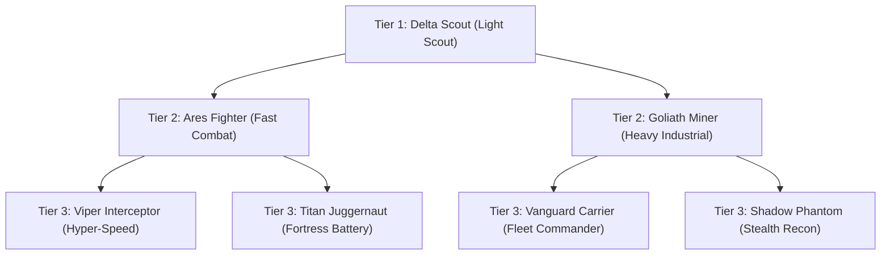

# 02 — Player Ships & Hangar Customization

> **Target:** Ship Concept Artists, 2D Modelers, Sprite Animators  
> **Topic:** The 7 Playable Player Hulls across Progression Tiers 1–3  

---

## 1. Ship Progression Architecture

In StarStrike, the player begins with the starter **Delta Scout** (Tier 1). During a run, collecting gems and surviving waves triggers the **Evolution System**, allowing the player to branch into Tier 2 (Combat vs. Mining) and Tier 3 specialized hulls:

---

## 2. Playable Ship Visual Specifications

### 2.1. Tier 1: Delta Scout (`ship_player_scout`)
* **Role:** Lightweight agile reconnaissance vessel (Starter Hull).
* **Canvas Size:** 64 x 64 px (2.0 x 2.0 Unity Units).
* **Silhouette:** Classic triangular delta-wing arrowhead. Sleek, minimal surface area.
* **Color Scheme:** Deep gunmetal body (`#1E293B`) with bright cyan racing stripes (`#00F0FF`) and a glowing sky-blue glass canopy.
* **Hardware Layout:**
  - **Weapon Hardpoints:** **1 Central Nose Mount** `(X: 0.0, Y: +0.65)`. Fires 1 central bullet stream.
  - **Engine Thrusters:** **1 Single Main Thruster Bell** at center stern `(X: 0.0, Y: -0.7)`.
* **Visual States Needed:**
  1. Base Hull (Diffuse + Emissive map).
  2. Banking Frames: 2 frames Left tilt, 2 frames Right tilt.
  3. Damaged Hull Variant (armor scorching and exposed wiring).

---

### 2.2. Tier 2: Ares Fighter (`ship_player_fighter`)
* **Role:** Multi-role space superiority strike craft.
* **Canvas Size:** 80 x 80 px (2.5 x 2.5 Unity Units).
* **Silhouette:** Aggressive forward-swept wings with wingtip canards. Angular cockpit canopy.
* **Color Scheme:** Dark cobalt plate armor (`#0F172A`) with hazard-cyan wing accents (`#38BDF8`) and white trim.
* **Hardware Layout:**
  - **Weapon Hardpoints:** **2 Twin Wing Hardpoints** at `(X: -0.38, Y: +0.35)` and `(X: +0.38, Y: +0.35)`. Fires 2 parallel bullet streams simultaneously.
  - **Engine Thrusters:** **Dual Twin Thrusters** at stern `(X: -0.25, Y: -0.7)` and `(X: +0.25, Y: -0.7)`.
* **Visual States Needed:**
  1. Base Hull.
  2. Thruster flare animations (Normal cruise vs. Afterburner boost).
  3. Banking roll frames (Left/Right).

---

### 2.3. Tier 2: Goliath Miner (`ship_player_miner`)
* **Role:** Heavy industrial asteroid harvester & armored gunboat.
* **Canvas Size:** 80 x 80 px (2.5 x 2.5 Unity Units).
* **Silhouette:** Bulky, utilitarian hexagonal hull. Reinforced prow mandibles, exposed hydraulic struts, external radiator grills.
* **Color Scheme:** Industrial gunmetal (`#334155`) with high-visibility hazard yellow striping (`#FACC15`) and emerald mining sensor lights (`#10B981`).
* **Hardware Layout:**
  - **Weapon Hardpoints:** **2 Heavy Outrigger Mounts** flanking the reinforced nose `(X: -0.42, Y: +0.4)` and `(X: +0.42, Y: +0.4)`.
  - **Engine Thrusters:** **Dual Heavy Cylindrical Thruster Blocks** at `(X: -0.32, Y: -0.65)` and `(X: +0.32, Y: -0.65)`.
* **Visual States Needed:**
  1. Base Hull with rotating ore intake turbines or pulsing green scanner array.
  2. Mining laser charge state (forward mandibles glow with heat).

---

### 2.4. Tier 3: Viper Interceptor (`ship_player_interceptor`)
* **Role:** Hyper-maneuverable hit-and-run dogfighter.
* **Canvas Size:** 64 x 64 px (2.0 x 2.0 Unity Units).
* **Silhouette:** Ultra-sharp needle prow, razor-thin double delta wings with rear stabilizers.
* **Color Scheme:** Obsidian black stealth matte (`#020617`) with brilliant electric cyan edge luminescence (`#06B6D4`).
* **Hardware Layout:**
  - **Weapon Hardpoints:** **2 Integrated Wing-Root Cannons** `(X: -0.30, Y: +0.45)` and `(X: +0.30, Y: +0.45)`.
  - **Engine Thrusters:** **3 Tri-Thruster Cluster** (1 central high-output thruster flanked by 2 micro-vectoring nozzles).
* **Visual States Needed:**
  1. Base Hull.
  2. Supersonic condensation cone / speed warp afterimage trail.

---

### 2.5. Tier 3: Titan Juggernaut (`ship_player_juggernaut`)
* **Role:** Heavily armored flying fortress with overwhelming broadside firepower.
* **Canvas Size:** 96 x 96 px (3.0 x 3.0 Unity Units).
* **Silhouette:** Massive broad triangular bastion. Heavy composite armor slabs, recessed bridge deck, reinforced forward prow wedge.
* **Color Scheme:** Heavy slate armor (`#1E293B`) with crimson warning lights (`#EF4444`) and reinforced titanium rivets.
* **Hardware Layout:**
  - **Weapon Hardpoints:** **3 Heavy Battery Hardpoints** `(X: -0.45, Y: +0.3)`, `(X: 0.0, Y: +0.65)`, and `(X: +0.45, Y: +0.3)`. Fires 3 devastating simultaneous battery shots across the screen.
  - **Engine Thrusters:** **Quad (4x) Heavy Plasma Nozzles** spanning the rear armor bulkhead.
* **Visual States Needed:**
  1. Base Hull.
  2. Reinforced Armor Shingles (subtle micro-animations when shields absorb heavy hits).

---

### 2.6. Tier 3: Vanguard Carrier (`ship_player_carrier`)
* **Role:** Fleet command flagship with autonomous point-defense and expanded energy banks.
* **Canvas Size:** 96 x 96 px (3.0 x 3.0 Unity Units).
* **Silhouette:** Extended catamaran or dual-hull chassis with central flight bay/antenna array.
* **Color Scheme:** Military naval navy-blue (`#1E3A8A`) with gold officer trim (`#F59E0B`) and bright blue navigation beacons.
* **Hardware Layout:**
  - **Weapon Hardpoints:** **3 Battery Slots** (1 dorsal spinal cannon + 2 sponson turrets).
  - **Engine Thrusters:** **Twin Primary Fusion Nacelles** mounted on outboard pylons.
* **Visual States Needed:**
  1. Base Hull with pulsing sensor dish and runway landing lights.
  2. Micro-drone launch port hatches (opening/closing state).

---

### 2.7. Tier 3: Shadow Phantom (`ship_player_phantom`)
* **Role:** Advanced electronic warfare, cloaking, and precision strike assassin.
* **Canvas Size:** 80 x 80 px (2.5 x 2.5 Unity Units).
* **Silhouette:** Faceted stealth fighter (resembling F-117/B-2 space evolution). Diamond geometry, zero straight 90-degree lines, shrouded thruster exhausts.
* **Color Scheme:** Deep carbon-fiber matte with deep ultraviolet/violet emissive traces (`#8B5CF6`).
* **Hardware Layout:**
  - **Weapon Hardpoints:** **2 Recessed Internal Bay Cannons** `(X: -0.32, Y: +0.38)` and `(X: +0.32, Y: +0.38)`.
  - **Engine Thrusters:** **Internal Linear Aerospike Slot Exhaust** (faint violet glow, zero visible protruding thruster bell).
* **Visual States Needed:**
  1. Normal Stealth State.
  2. Cloaking / Disruption Transition (translucent glitch/hologram phase effect).

---

## 3. Ship Sprite Sheet Deliverables Matrix

For each of the 7 hulls, the artist must export:

| Texture File | Format | Contents |
| :--- | :--- | :--- |
| `[ship_name]_diffuse.png` | RGBA 32-bit | Full-color base hull illustration with clean transparent background. |
| `[ship_name]_emissive.png` | RGB 24-bit | Black background with pure white/colored emissive masks for cockpits, running lights, and nozzles. |
| `[ship_name]_damaged.png` | RGBA 32-bit | Hull variant with 50% health damage: scorch marks, cracked canopy, exposed interior circuitry. |
| `[ship_name]_turn_sheet.png` | RGBA 32-bit | 5-frame bank animation: Hard Left, Soft Left, Neutral Center, Soft Right, Hard Right. |
| `[ship_name]_icon.png` | 128x128 px | High-res orthographic badge with hexagonal frame for Hangar UI and Evolution selection cards. |
