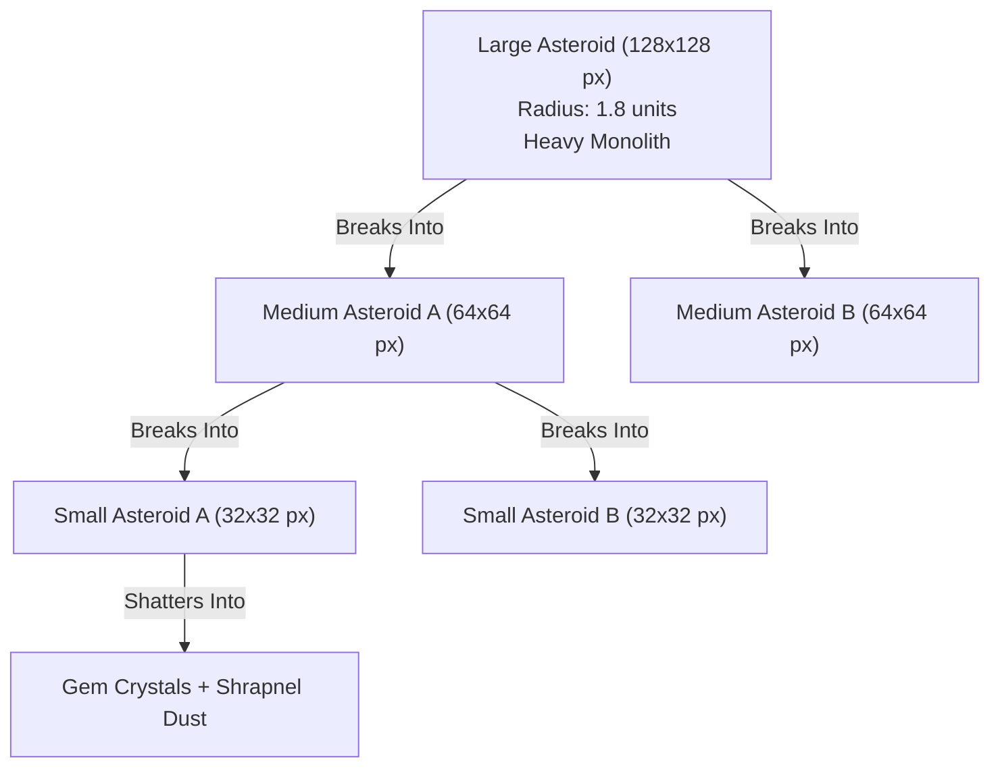

# Sprite Specification: Asteroid System & Breakup (`env_asteroids`)

> **Category:** Environment & World Objects — Asteroid Hazards  
> **Target Audience:** 2D Environment Artist & Physics Asset Specialist  
> **In-Game Role:** Destructible physical cover, mining nodes & collision hazards  

---

## 1. Concept & Visual Identity

Asteroids are the physical lifeblood of StarStrike. They act as dynamic cover from laser fire, navigation hazards, and resource vaults for gems. They feature brutal, faceted geological silhouettes with visible impact craters and fracture lines.

* **Pivot Point:** Exact Center `(0.5, 0.5)` for smooth physics rotation.
* **Texture Palette:** Dark charcoal and slate basalt (`#334155`), with mineral veins glowing emerald (`#10B981`) or cyan (`#00F0FF`).

---

## 2. Asteroid Size Classes & Fracture Tree

---

## 3. Geological Variants

1. **Rocky Silicate (Standard):** Pitted volcanic basalt with deep shadow craters and sharp chipped edges.
2. **Metallic Nickel-Iron:** Specular metallic sheen along sharp ridges. Emits sparks when struck by bullets.
3. **Crystal-Infused (Resource Rich):** Intersected by glowing veins of raw emerald/cyan energy crystal. Cracks glow brighter when damaged.

---

## 4. Required Visual Deliverables

1. `env_asteroid_large_01.png` & `02.png` (128x128 px, 32-bit RGBA) — 2 distinct heavy monolith asteroids.
2. `env_asteroid_med_01.png` through `04.png` (64x64 px, 32-bit RGBA) — 4 medium boulder variants.
3. `env_asteroid_small_01.png` through `04.png` (32x32 px, 32-bit RGBA) — 4 small gravel chunk variants.
4. `env_asteroid_crystal_vein_emissive.png` (128x128 px) — Emissive mask for glowing crystal-infused variants.
5. `env_asteroid_shrapnel_atlas.png` (128x128 px) — 8 irregular stone debris fragments for physics explosion emission.
