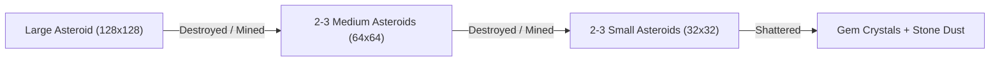

# 05 — Environment, Asteroids & Sector Biomes

> **Target:** Environment Artists, Level Concept Artists, Matte Painters  
> **Topic:** Celestial Objects, Mining Minerals, Sector Biomes & Space Hazards  

---

## 1. Environment Art Vision

Space in StarStrike is not an empty black void — it is a **dynamic, hazardous, and living celestial battlefield**. The player navigates through dense asteroid fields, glowing mineral clusters, and turbulent radiation zones that serve both as tactical cover and deadly obstacles.

---

## 2. Asteroids & Breakup Architecture

Asteroids serve three core gameplay functions: **physical cover from lasers**, **ramming hazards**, and **economic resource nodes for gems**.



### 2.1. Asteroid Size Classes & Geology
| Class | Canvas Size | World Scale | Mass / Physics | Visual Features |
| :--- | :--- | :--- | :--- | :--- |
| **Small Asteroid** | 32 x 32 px | 1.0 x 1.0 unit | Light (Can be nudged) | Sharp, jagged gravel chunk with 1–2 small impact craters. |
| **Medium Asteroid** | 64 x 64 px | 2.0 x 2.0 units | Medium | Faceted boulder with visible mineral striations and fracture lines. |
| **Large Asteroid** | 128 x 128 px | 4.0 x 4.0 units | Immovable Heavy | Massive monolithic rock with deep craters, caverns, and glowing crystal veins. |

### 2.2. Geological Surface Variants
1. **Rocky Silicate (Standard):** Slate gray and charcoal (`#334155`), matte stone texture with dust pitting.
2. **Metallic Nickel-Iron:** Dark bronze/iron luster with sharp specular glints along razor ridges. Deflects low-damage bullets.
3. **Crystal-Infused (Resource Rich):** Intersected by glowing veins of emerald or cyan ore (`#10B981`, `#00F0FF`). Cracks illuminate when damaged, indicating high gem drop yield.

### 2.3. Breakup Debris Sprites
* When asteroids shatter, they must NOT vanish into thin air.
* Deliver an **Asteroid Shrapnel Sheet** containing:
  - 6 distinct irregular stone fragments (12x12 to 24x24 px).
  - 3 micro-pebble dust particles for physics particle emission.

---

## 3. Collectibles, Crystals & Power-Up Items

### 3.1. Mining Gem Crystals (`pickup_gem_crystal`)
* **Concept:** High-energy raw mineral shards dropped from shattered asteroids and destroyed elite ships.
* **Canvas Size:** 16 x 16 px (0.5 x 0.5 Unity Units).
* **Silhouette:** Octahedral or faceted double-pyramid crystal gem.
* **Color Palette:** Luminous Emerald Green (`#10B981`) with pure white specular tip (`#FFFFFF`).
* **Visual FX:**
  - Gentle 360-degree floating rotation loop.
  - Pulses with a subtle green halo.
  - Emits a faint trail of green glitter sparkles when magnetically pulled toward the player ship.

### 3.2. Tactical Power-Up Items (`pickup_powerup_[type]`)
Power-ups are high-priority tactical drops encased in glowing containment capsules:

```
    [ OVERDRIVE ]              [ SHIELD RESTORE ]            [ SPEED INJECTOR ]
  Red Diamond Prism         Cobalt Blue Energy Sphere      Emerald Green Double Chevron
 +1 Hardpoint / FireRate       Instant Shield Recovery       Max Speed & Acceleration Boost
```

* **Canvas Size:** 32 x 32 px (1.0 x 1.0 Unity Units).
* **Visual Design:** Floating 2D orthographic icon surrounded by a spinning, translucent energy ring.

---

## 4. Sector Biomes & Environmental Themes

The game features **4 distinct sector biomes**, each with unique background palettes, lighting setups, and gameplay hazards:

### 4.1. Sector 1: The Deep Void (Standard Space)
* **Atmosphere:** Vast, tranquil, and lonely cosmic expanse.
* **Background Palette:** Near-black navy gradient (`#020617` to `#0B0F19`) layered with distant indigo/cobalt nebulae clouds.
* **Lighting:** Cold, subtle ambient starlight.
* **Background Parallax Layers:**
  - Layer 1 (Far): Dense field of tiny, static twinkling white stars.
  - Layer 2 (Mid): Drifting soft cosmic dust motes.
  - Layer 3 (Near): Occasional large silhouetted derelict space station hulls in deep background blur.

---

### 4.2. Sector 2: The Crystal Belt (Mining Hub)
* **Atmosphere:** Luminous, reflective, and resource-heavy asteroid cluster.
* **Background Palette:** Deep turquoise and emerald cosmos gas clouds (`#064E3B`, `#0F766E`).
* **Lighting:** Cool cyan/green ambient backlight reflecting off mineral surfaces.
* **Visual Elements:**
  - High density of crystal-veined asteroids.
  - Sparkling fields of ambient microscopic mineral dust motes drifting through space.

---

### 4.3. Sector 3: Solar Flare Radiation Zone (Extreme Hazard)
* **Atmosphere:** Blistering, high-heat orbital zone near an active star.
* **Background Palette:** Fiery gradients of dark amber, burning crimson, and solar yellow (`#7F1D1D`, `#D97706`).
* **Hazard Mechanics & Visuals:**
  - **Solar Flare Waves:** Every 30 seconds, a glowing wall of burning orange solar radiation sweeps across the screen.
  - **Asteroid Shadow Shelters:** Large asteroids cast deep, safe **shadow umbrellas** behind them. The artist must provide soft directional shadow projections so the player clearly understands where to hide to avoid radiation damage!

---

### 4.4. Sector 4: Nebular Ion Storm (Electronic Warfare)
* **Atmosphere:** Volatile, unstable storm front filled with ionized plasma and electrical discharges.
* **Background Palette:** Stormy magenta, electric purple, and dark violet gas clouds (`#581C87`, `#3B0764`).
* **Hazard Mechanics & Visuals:**
  - **Atmospheric Lightning:** Forked lightning arcs randomly flash between nebula clouds in the background.
  - **Radar Interference:** HUD minimap and screen edges flicker with cyan static/noise whenever the player enters dense ion pockets.
