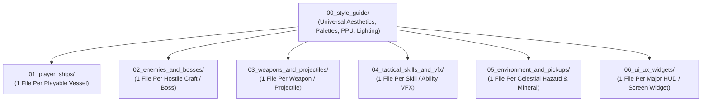

# StarStrike — Game Art Production Bible & Sprite Design Suite

> **Version:** 2.0.0 (Modular Sprite Production Master)  
> **Target Engine:** Unity 6 LTS (Universal Render Pipeline - 2D Renderer)  
> **Architecture:** Dedicated Style Guides + 1-to-1 Sprite Design Specifications  

---

## 1. Documentation Structure & Artist Workflow

This documentation suite is organized so you can hand your game artist **the overarching Game Style files** for universal rules, plus **the exact individual markdown file for each specific sprite** they are assigned to illustrate.

---

## 2. Master Document Index & File Directory

### Part I: Overarching Game Style & Technical Rules (`00_style_guide/`)
* **[style_art_direction_and_pillars.md](file:///home/quan/projects/starstrike/docs/art_specifications/00_style_guide/style_art_direction_and_pillars.md)**  
  *Core aesthetic identity (Neo-Retro Space Combat / Clean Industrial Cyberpunk), visual silhouette philosophy, linework thickness, and 2-to-3 tone cel-shading rules.*
* **[style_palettes_and_emissives.md](file:///home/quan/projects/starstrike/docs/art_specifications/00_style_guide/style_palettes_and_emissives.md)**  
  *Universal functional color binding (`Cyan #00F0FF` = player, `Crimson #FF0055` = hostiles, `Azure #3B82F6` = shields, `Emerald #10B981` = gems) and URP 2D Bloom emissive texture mask requirements.*
* **[style_technical_constraints.md](file:///home/quan/projects/starstrike/docs/art_specifications/00_style_guide/style_technical_constraints.md)**  
  *Strict 32 Pixels Per Unit (PPU) world scale, canvas matrix (16px to 256px), center pivots `(0.5, 0.5)`, right-facing orientation (+X), render layer sorting, and POT atlasing.*

---

### Part II: Individual Sprite Design Specifications

#### 1. Player Vessels (`01_player_ships/`)
* **[ship_delta_scout.md](file:///home/quan/projects/starstrike/docs/art_specifications/01_player_ships/ship_delta_scout.md)** — Tier 1 Starter Agile Scout (64x64px, 1 Central Nose Cannon, 1 Stern Thruster).
* **[ship_ares_fighter.md](file:///home/quan/projects/starstrike/docs/art_specifications/01_player_ships/ship_ares_fighter.md)** — Tier 2 Combat Strike Fighter (80x80px, Forward-Swept Wings, 2 Parallel Wing Hardpoints).
* **[ship_goliath_miner.md](file:///home/quan/projects/starstrike/docs/art_specifications/01_player_ships/ship_goliath_miner.md)** — Tier 2 Heavy Industrial Miner (80x80px, Reinforced Prow Mandibles, Hazard Stripes, 2 Heavy Mining Lasers).
* **[ship_viper_interceptor.md](file:///home/quan/projects/starstrike/docs/art_specifications/01_player_ships/ship_viper_interceptor.md)** — Tier 3 Hyper-Speed Needle Interceptor (64x64px, Knife-Edge Delta, Tri-Afterburners).
* **[ship_titan_juggernaut.md](file:///home/quan/projects/starstrike/docs/art_specifications/01_player_ships/ship_titan_juggernaut.md)** — Tier 3 Fortress Bastion Dreadnought (96x96px, 3 Heavy Battery Cannons, Quad Fusion Wall).
* **[ship_vanguard_carrier.md](file:///home/quan/projects/starstrike/docs/art_specifications/01_player_ships/ship_vanguard_carrier.md)** — Tier 3 Fleet Command Cruiser (96x96px, Catamaran Dual-Hull, Drone Flight Deck, 3 Battery Slots).
* **[ship_shadow_phantom.md](file:///home/quan/projects/starstrike/docs/art_specifications/01_player_ships/ship_shadow_phantom.md)** — Tier 3 Stealth Recon Phantom (80x80px, Faceted Diamond Stealth Geometry, Recessed Internal Bays).

#### 2. Hostile Armada & Bosses (`02_enemies_and_bosses/`)
* **[enemy_patrol_drone.md](file:///home/quan/projects/starstrike/docs/art_specifications/02_enemies_and_bosses/enemy_patrol_drone.md)** — Swarm Drone (48x48px, Predatory Charcoal Dart, Crimson Cyclops Optic).
* **[enemy_kamikaze_rammer.md](file:///home/quan/projects/starstrike/docs/art_specifications/02_enemies_and_bosses/enemy_kamikaze_rammer.md)** — Suicide Diver (56x56px, Molten Orange Warhead Core, Strobe Dive Telegraph, 4.5m Blast).
* **[enemy_railgun_sniper.md](file:///home/quan/projects/starstrike/docs/art_specifications/02_enemies_and_bosses/enemy_railgun_sniper.md)** — Standoff Sniper (72x48px, Asymmetric Long Barrel, Violet Capacitor Charge Sequence & Laser Telegraph).
* **[enemy_support_shield_cruiser.md](file:///home/quan/projects/starstrike/docs/art_specifications/02_enemies_and_bosses/enemy_support_shield_cruiser.md)** — Fleet Shield Cruiser (80x80px, Hexagonal Platform with 3 Orbiting Coils, Blue Invulnerability Tethers).
* **[boss_dreadnought_flagship.md](file:///home/quan/projects/starstrike/docs/art_specifications/02_enemies_and_bosses/boss_dreadnought_flagship.md)** — Capital Boss (256x256px, Phase 1 Armored Bastion with Rotating Flak Turrets -> Phase 2 Overheated Berserk Rage with Exposed Molten Fusion Core).

#### 3. Weapons & Projectiles (`03_weapons_and_projectiles/`)
* **[proj_pulse_laser.md](file:///home/quan/projects/starstrike/docs/art_specifications/03_weapons_and_projectiles/proj_pulse_laser.md)** — Weapon 1 Primary Energy Bolt (16x32px, Cyan/White Plasma Core, Muzzle Flares).
* **[proj_scattergun_pellets.md](file:///home/quan/projects/starstrike/docs/art_specifications/03_weapons_and_projectiles/proj_scattergun_pellets.md)** — Weapon 2 Close-Range Kinetic Shotgun (12x12px Incandescent Tungsten Slugs, Conical Propellant Smoke).
* **[proj_swarm_missiles.md](file:///home/quan/projects/starstrike/docs/art_specifications/03_weapons_and_projectiles/proj_swarm_missiles.md)** — Weapon 3 Seeker Micro-Rockets (16x32px, Finned Body, Twisting Smoke Ribbons, HUD Target Lock Reticle).
* **[proj_tachyon_beam.md](file:///home/quan/projects/starstrike/docs/art_specifications/03_weapons_and_projectiles/proj_tachyon_beam.md)** — Weapon 4 Sustained Laser (3-Piece Modular System: Lens Flare Emitter, Tiling Beam Body, Impact Contact Spark Splash).

#### 4. Tactical Skills & Abilities (`04_tactical_skills_and_vfx/`)
* **[skill_forward_shockwave.md](file:///home/quan/projects/starstrike/docs/art_specifications/04_tactical_skills_and_vfx/skill_forward_shockwave.md)** — Active 1 Kinetic Displacement (64x32px Curved Crescent Compression Wave, Vacuum Wake).
* **[skill_micro_warp_blink.md](file:///home/quan/projects/starstrike/docs/art_specifications/04_tactical_skills_and_vfx/skill_micro_warp_blink.md)** — Active 2 Subspace Teleport (3 Fading Afterimage Ghost Silhouettes, Chromatic Snap Flare).
* **[skill_emp_nova.md](file:///home/quan/projects/starstrike/docs/art_specifications/04_tactical_skills_and_vfx/skill_emp_nova.md)** — Active 3 Electromagnetic Blast (Expanding 9.5-unit Neon Cyan Shockwave Ring, Target Lightning Arcs).
* **[skill_reactive_barrier.md](file:///home/quan/projects/starstrike/docs/art_specifications/04_tactical_skills_and_vfx/skill_reactive_barrier.md)** — Passive Deflector Surge (Hexagonal Honeycomb Wireframe Sphere with Impact Ripples).

#### 5. Environment & Pickups (`05_environment_and_pickups/`)
* **[env_asteroids_system.md](file:///home/quan/projects/starstrike/docs/art_specifications/05_environment_and_pickups/env_asteroids_system.md)** — Destructible Celestial Cover (Large 128px -> Medium 64px -> Small 32px Fracture Hierarchy, Mineral Vein Masks, Shrapnel Atlas).
* **[pickup_gem_crystals.md](file:///home/quan/projects/starstrike/docs/art_specifications/05_environment_and_pickups/pickup_gem_crystals.md)** — Economic Crystals (16x16px Faceted Emerald Gems with 6-Frame Tumble Loop).
* **[pickup_tactical_powerups.md](file:///home/quan/projects/starstrike/docs/art_specifications/05_environment_and_pickups/pickup_tactical_powerups.md)** — In-Run Combat Boosts (Red Overdrive Diamond, Blue Shield Sphere, Green Speed Chevrons).
* **[env_sector_biomes.md](file:///home/quan/projects/starstrike/docs/art_specifications/05_environment_and_pickups/env_sector_biomes.md)** — 4 Sector Backdrops (Deep Void, Crystal Belt, Solar Flare Radiation Wave with Asteroid Shadow Shelters, Nebular Ion Storm).

#### 6. UI / UX Design System (`06_ui_ux_widgets/`)
* **[ui_hud_vital_arcs.md](file:///home/quan/projects/starstrike/docs/art_specifications/06_ui_ux_widgets/ui_hud_vital_arcs.md)** — Flight Telemetry Display (Concentric Curved Shield & Energy Arcs, Segmented Hull Health).
* **[ui_hud_minimap_radar.md](file:///home/quan/projects/starstrike/docs/art_specifications/06_ui_ux_widgets/ui_hud_minimap_radar.md)** — Tactical Minimap Scope (160x160px Scope, 360° Rotating Sweep Line, Custom Entity Blips).
* **[ui_modal_evolution_cards.md](file:///home/quan/projects/starstrike/docs/art_specifications/06_ui_ux_widgets/ui_modal_evolution_cards.md)** — Mid-Run Evolution Modal (320x480px Side-by-Side Holographic Glass Choice Cards).
* **[ui_screen_hangar_showcase.md](file:///home/quan/projects/starstrike/docs/art_specifications/06_ui_ux_widgets/ui_screen_hangar_showcase.md)** — Hangar Ship Selection Bay (Drydock Gantries, Rotating Floor Turntable, Telemetry Stat Gauges).
* **[ui_iconography_master.md](file:///home/quan/projects/starstrike/docs/art_specifications/06_ui_ux_widgets/ui_iconography_master.md)** — Complete 64x64px Vector Icon Sheet (Weapons, Skills, Ship Attributes, Currency).

---

## 3. How to Assign Work to Artists

When commissioning or briefing your game artist:
1. **Always provide the 3 Game Style guides** in [`00_style_guide/`](file:///home/quan/projects/starstrike/docs/art_specifications/00_style_guide/style_art_direction_and_pillars.md) first so they understand the aesthetic vision, color rules, and technical PPU constraints.
2. **Assign individual sprite files** for their specific tasks (e.g. give them [`ship_ares_fighter.md`](file:///home/quan/projects/starstrike/docs/art_specifications/01_player_ships/ship_ares_fighter.md) when asking for the Fighter sprite, or [`boss_dreadnought_flagship.md`](file:///home/quan/projects/starstrike/docs/art_specifications/02_enemies_and_bosses/boss_dreadnought_flagship.md) when asking for the capital boss). Each file contains exact canvas dimensions, normalized hardpoint coordinates (X, Y), and a full deliverables checklist.
