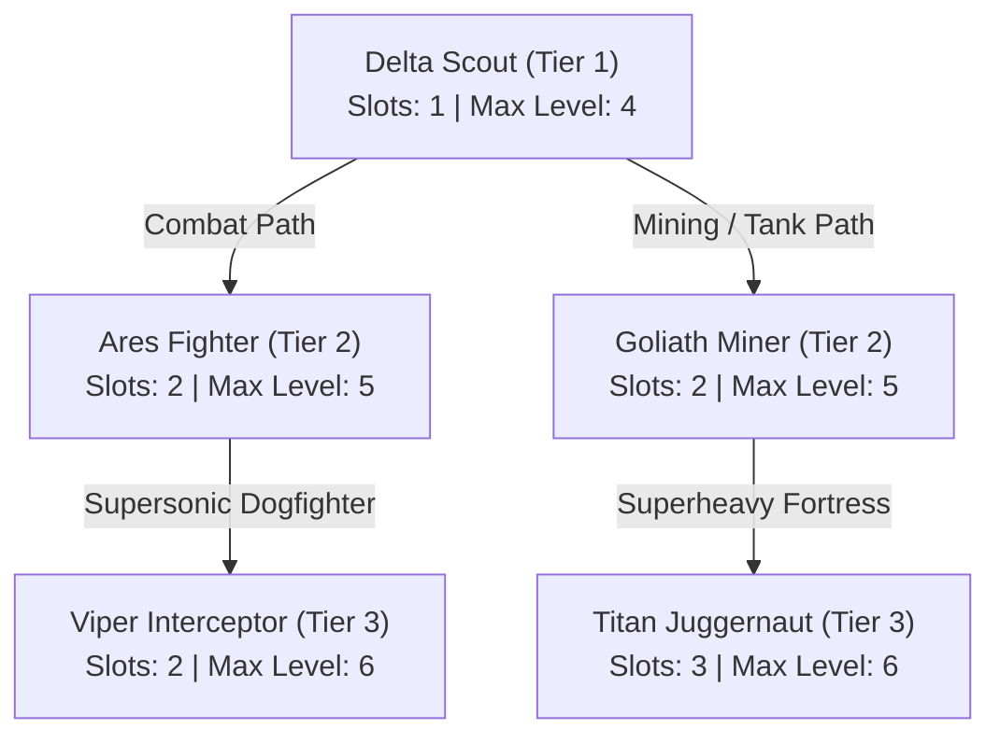

# Ship Classes & Progression Guide

StarStrike features a multi-tier ship evolution system where pilots progress from lightweight reconnaissance craft into specialized combat interceptors or heavy dreadnoughts.

---

## 1. Ship Evolution Hierarchy

The ship tree branches across three distinct tiers:



---

## 2. Complete Ship Specifications

| Attribute | Delta Scout (T1) | Ares Fighter (T2) | Goliath Miner (T2) | Viper Interceptor (T3) | Titan Juggernaut (T3) |
| :--- | :--- | :--- | :--- | :--- | :--- |
| **Role** | Starter Recon | Strike Combat | Industrial Miner | High-Speed Hunter | Superheavy Fortress |
| **Max Upgrade Level** | 4 | 5 | 5 | 6 | 6 |
| **Weapon Slots** | 1 Muzzle | 2 Dual Muzzles | 2 Dual Muzzles | 2 Dual Muzzles | 3 Triple Muzzles |
| **Shield Capacity** | 100 HP | 150 HP | 220 HP | 180 HP | 400 HP |
| **Shield Regeneration**| 8 HP/s | 12 HP/s | 16 HP/s | 15 HP/s | 25 HP/s |
| **Energy Capacity** | 80 Units | 120 Units | 150 Units | 140 Units | 200 Units |
| **Energy Regeneration**| 18 U/s | 24 U/s | 20 U/s | 30 U/s | 25 U/s |
| **Pulse Laser Damage** | 18 | 28 | 40 | 35 | 75 |
| **Pulse Laser Speed** | 600 | 680 | 520 | 800 | 480 |
| **Top Flight Speed** | 260 | 310 | 210 | 400 | 180 |
| **Agility (Turn Rate)** | 4.5 rad/s | 5.0 rad/s | 3.5 rad/s | 6.5 rad/s | 2.5 rad/s |
| **Scale / Hitbox** | 1.0x (r: 0.5) | 1.2x (r: 0.6) | 1.35x (r: 0.68)| 1.2x (r: 0.6) | 1.5x (r: 0.75) |

---

## 3. Playstyle Profiles

### Delta Scout (Tier 1)
- **Role**: Baseline all-rounder craft given to every pilot at mission start.
- **Strengths**: Balanced speed and turning rate; low upgrade cost to unlock early evolutions.
- **Weaknesses**: Single pulse weapon slot limits burst damage against large asteroid clusters and drone packs.

### Ares Fighter (Tier 2)
- **Role**: Dedicated dogfighting platform designed for aggressive swarm elimination.
- **Strengths**: Dual muzzles double damage output; agile turning rate allows easy circle-strafing of drone wings.
- **Weaknesses**: Modest energy capacity requires careful boost management during protracted firefights.

### Goliath Miner (Tier 2)
- **Role**: Heavy industrial craft built to absorb collisions and shatter dense asteroid fields.
- **Strengths**: Large shield reservoir (220 HP) and heavy single-shot damage (40); high mass resists asteroid knockback.
- **Weaknesses**: Slower sub-light speed (210) makes evading high-speed enemy fire challenging without preemptive auto-braking.

### Viper Interceptor (Tier 3)
- **Role**: Hyper-agile pursuit vessel engineered for lightning hit-and-run strikes.
- **Strengths**: Highest top speed in the fleet (400) and unmatched agility (6.5 rad/s); ultra-fast energy recharge (30 U/s) supports near-continuous boosting and beam firing.
- **Weaknesses**: Lower shield reserve than the Juggernaut; demands precise pilot reflexes to avoid high-speed boundary impacts.

### Titan Juggernaut (Tier 3)
- **Role**: Flying dreadnought with overwhelming frontal firepower and impenetrable defensive matrices.
- **Strengths**: Colossal 400 HP shield reserve with 25 HP/s regen; 3 parallel weapon slots firing massive 75-damage bolts; immune to minor collision disorientation.
- **Weaknesses**: Slowest flight profile (180 speed, 2.5 rad/s turn); large collision profile makes dodging boss projectile spreads difficult.

---

## 4. In-Run Upgrade Economics

Gems harvested from asteroids and destroyed drones can be allocated across 8 distinct subsystem categories via [PlayerProgression.cs](file:///home/quan/projects/starstrike/unity/Assets/_Project/Scripts/Gameplay/Progression/PlayerProgression.cs):

### Upgrade Categories & Stat Multipliers

```
Effective Stat = Base Stat * (1 + Stat Level * Multiplier)
```

1. **Shield Capacity**: `+15%` max shields per level.
2. **Shield Regeneration**: `+15%` shield recovery rate per level.
3. **Energy Capacity**: `+15%` max energy pool per level.
4. **Energy Regeneration**: `+15%` energy recharge rate per level.
5. **Pulse Damage**: `+12%` weapon projectile damage per level.
6. **Pulse Speed**: `+10%` projectile velocity per level.
7. **Top Flight Speed**: `+10%` ship max speed per level.
8. **Agility**: `+10%` rotational rate per level.

### Upgrade Cost Formula
The gem cost to upgrade any stat follows an escalating tier curve:
$$\text{Cost} = \text{Base Cost} \times (1 + \text{Current Level})$$
- Level 0 $\rightarrow$ Level 1: **10 Gems**
- Level 1 $\rightarrow$ Level 2: **15 Gems**
- Level 2 $\rightarrow$ Level 3: **20 Gems**
- Level 3 $\rightarrow$ Level 4: **25 Gems**
- Level 4 $\rightarrow$ Level 5: **30 Gems**
- Level 5 $\rightarrow$ Level 6: **35 Gems**

---

## 5. Meta-Progression & Persistence

StarStrike implements persistent progression managed by [StorageService.cs](file:///home/quan/projects/starstrike/unity/Assets/_Project/Scripts/Platform/Storage/StorageService.cs):

- **Meta-Gems Stash**: All unspent gems collected during a run (or awarded upon run completion) are deposited into your permanent hangar account upon Victory or Game Over.
- **Starting Ship Unlocks**: Once you have unlocked an advanced hull during any run, you can select it from the Main Menu Ship Carousel as your default deployment craft for future expeditions.
- **Persistent Settings**: Player preferences including Aim Mode (Mouse Direct vs. Classic Turn), Mouse Sensitivity, Auto-Braking, Invert Turn, and Audio Volumes are saved across restarts to local disk storage (`PlayerPrefs` or platform file storage).
- **Achievements**: Milestones such as defeating the Dreadnought Boss or evolving to Tier 3 grant permanent bragging rights and track cumulative statistics across all game sessions.
