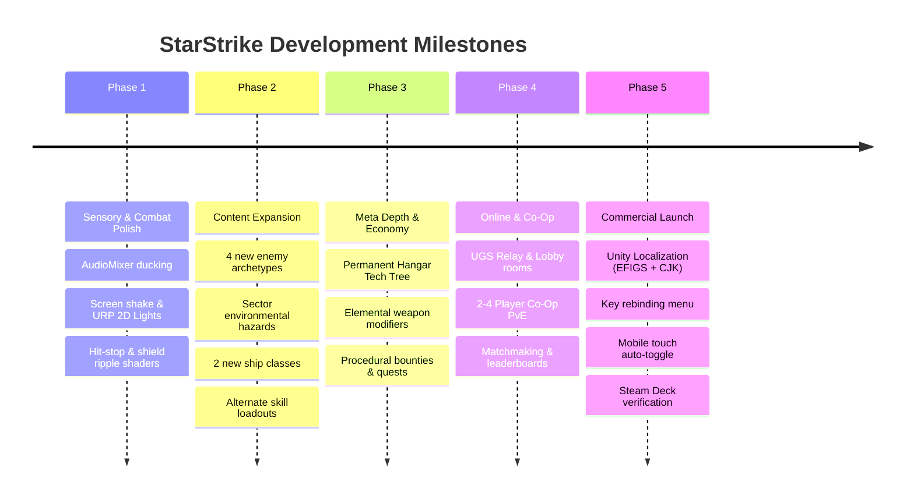

# StarStrike Strategic Development Roadmap

This document outlines the phased development roadmap to transition **StarStrike** from its current functional vertical slice into a commercially viable, feature-complete release on PC (Steam) and Mobile.

---

## Roadmap Timeline & Milestones

---

## Phase 1: Sensory & Combat Polish (Immediate Priority)

The highest return-on-investment phase focused on elevating the game's tactile feedback and visual dynamism.

### 1.1 Audio Architecture Overhaul
- **AudioMixer Setup**: Wire `masterMixer`, `musicGroup`, `sfxGroup`, and `uiGroup` in [AudioConfig.asset](file:///home/quan/projects/starstrike/unity/Assets/_Project/Resources/Data/AudioConfig.asset).
- **Audio Ducking**: Duck background music by -4dB when heavy explosions or boss laser batteries detonate.
- **Dynamic Combat Music Stems**: Implement a dynamic music manager transitioning seamlessly between low-tension mining stems and high-bpm combat stems when enemies engage.
- **Engine Loops**: Add looping thruster audio with pitch modulation tied to `rb.linearVelocity.magnitude`.

### 1.2 Combat Juice & Screen Shake
- **Camera Impulse**: Integrate a camera shake system triggered on taking shield damage (1.5 magnitude) and destroying asteroids (0.8 magnitude).
- **Hit-Stop / Micro-Freezes**: Implement 2-frame time-scale freeze (`Time.timeScale = 0.05f`) upon destroying the Dreadnought Boss or landing critical scattergun bursts.
- **URP 2D Dynamic Point Lights**: Add glowing 2D lights to player pulse bolts (cyan), enemy lasers (red), explosion fireballs (orange), and gem crystals (emerald).

### 1.3 Shader Polish
- **Shield Impact Ripples**: Create a custom URP Sprite Shader displaying a brief hex-pattern ripple at the world collision point when shields absorb damage.
- **Flash-on-Damage**: Implement a white silhouette flash shader on all enemy ships and player craft upon receiving projectile damage.

---

## Phase 2: Content & Enemy Expansion (Next Cycle)

Expanding gameplay variety to ensure runs feel varied, unpredictable, and challenging.

### 2.1 Diverse Enemy Archetypes
- **Kamikaze Swarmer**: Ultra-fast, low-HP drones that rush the player and detonate in a shockwave upon contact.
- **Sniper Turret Rig**: Stationary armored platforms deployed outside radar range firing high-speed piercing beams.
- **Support Shield Frigate**: Projects a directional invulnerability barrier shielding nearby combat drones until eliminated.

### 2.2 Sector Biomes & Cosmic Hazards
- **Sector 1 (Belt Outpost)**: Current asteroid belt sector; standard mining and drone patrols.
- **Sector 2 (Ion Nebula)**: Electrical storms disable auto-braking and scramble radar blips; lightning arcs across clustered asteroids.
- **Sector 3 (Solar Flare Zone)**: Periodic radiant waves sweeping across the screen; pilots must shelter behind large asteroids to prevent shield burns.
- **Sector 4 (Event Horizon)**: Central gravitational singularity pulling all entities inward; requires continuous thruster discipline.

### 2.3 Additional Playable Hulls & Alternate Skills
- **Vanguard Carrier (Tier 3)**: Deploys 2 autonomous mini-drones that automatically mine nearby asteroids or engage enemy wings.
- **Shadow Phantom (Tier 3)**: Equipped with a cloaking cloak skill granting 4 seconds of stealth and $+50\%$ critical strike damage upon decloaking.
- **Skill Loadout Selection**: UI screen allowing pilots to swap `ForwardShockwave` for `Blink Teleport` or `EMP Nova`.

---

## 3. Phase 3: Meta-Progression & Depth (Mid-Term)

Transforming the game into an addictive roguelite loop with long-term retention.

### 3.1 Permanent Hangar Tech Tree
- **Meta-Gems Foundry**: A dedicated menu accessible from the Main Menu allowing players to invest mined gems into permanent perks:
  - *Tractor Beam Amplification*: $+10\%\text{--}50\%$ gem magnet collection radius.
  - *Hull Reinforcement*: $+10\%\text{--}40$ baseline shield capacity across all ships.
  - *Mineral Refining*: $+15\%$ gem yield from medium and large asteroids.
  - *Overdrive Catalyst*: $+2\text{--}6$ seconds increased duration for weapon overdrive power-ups.

### 3.2 Elemental Weapon Status Effects
- **Plasma Mod**: Weapon hits apply damage-over-time melting armor.
- **Cryo Mod**: Slows enemy linear velocity and turning agility by $40\%$.
- **Chain Mod**: Laser impacts arc electricity to up to 2 adjacent drones.

### 3.3 Dynamic In-Run Bounties
- Procedural mission cards appearing at wave start (e.g., *"Shatter 12 asteroids within 30 seconds"*, *"Eliminate 5 drones using only the Scattergun"*) awarding bonus meta-gems and guaranteed power-ups.

---

## 4. Phase 4: Multiplayer Expansion & Online Infrastructure

Unlocking modern online multiplayer play.

### 4.1 Unity Gaming Services (UGS) Integration
- **UGS Relay**: Replace direct IP entry with Relay allocation codes, allowing seamless host/join through home firewalls and mobile carrier NATs.
- **UGS Lobby**: Public and private lobby browser displaying game regions, player ping, and match settings.

### 4.2 2-to-4 Player Co-Op PvE Mode
- Expand [NetworkMatchManager.cs](file:///home/quan/projects/starstrike/unity/Assets/_Project/Scripts/Network/NetworkMatchManager.cs) to synchronize the PvE wave director:
  - Shared wave countdown timers.
  - Scaled enemy swarm density based on active connected player count.
  - Synchronized Dreadnought Boss encounter with co-op focus fire.

---

## 5. Phase 5: Commercial Launch & Platform Release

Final hardening for commercial storefront publication.

### 5.1 Accessibility & Control Polish
- **Keybinding Remapping UI**: In-game settings panel allowing players to rebind all keyboard, mouse, and gamepad actions.
- **Dynamic Controller Glyphs**: Auto-detecting input devices to show Xbox, PlayStation, Switch, or PC key icons dynamically on HUD prompts.
- **Adaptive Touch Controls**: Automatically enabling `VirtualJoystick` and `TouchButton` on mobile platforms while disabling them on desktop/consoles.

### 5.2 Multi-Language Localization
- Implement Unity Localization package covering English, German, French, Spanish, Japanese, Korean, Simplified Chinese, and Vietnamese.
- Externalize all UI text, ship lore, upgrade labels, and tutorial tips into String Tables.

### 5.3 Steam & Mobile Store Certification
- **Steam Deck Verification**: Full 16:10 display support (1280x800), default controller mapping, and 60 FPS battery profile.
- **Mobile Performance Optimization**: Zero-allocation memory audit, battery saving frame-rate throttles, and notch safe area compliance.
