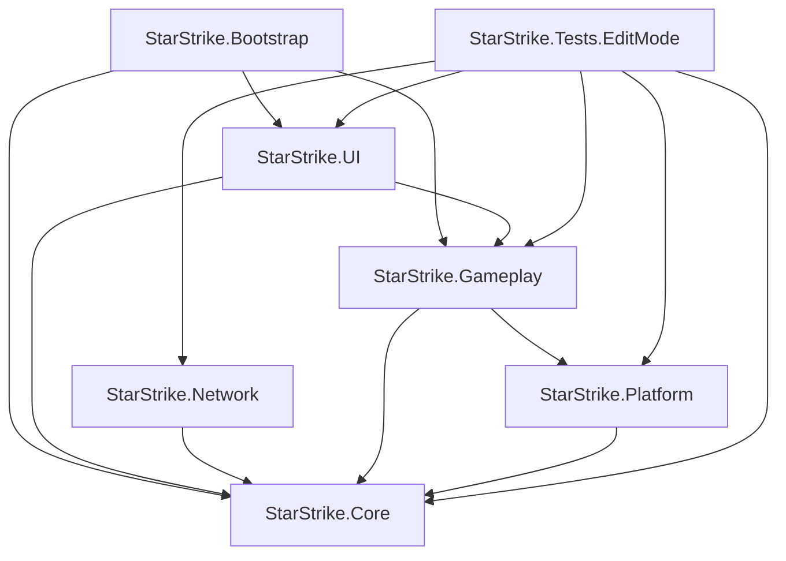
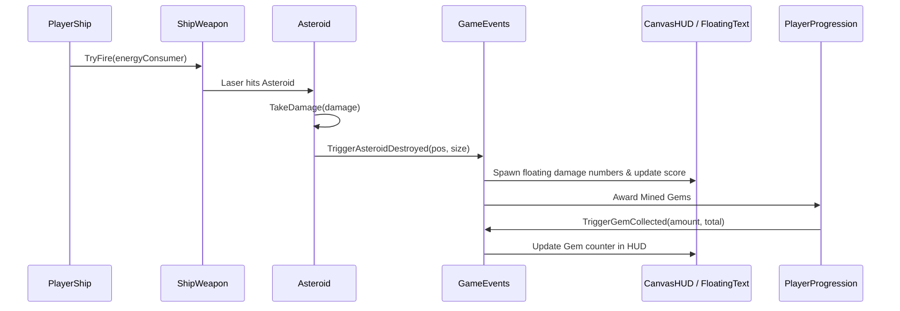

# StarStrike Technical Architecture & Systems Design

This document details the software engineering architecture, assembly boundaries, and design patterns governing **StarStrike**.

---

## 1. Assembly Definition (ASMDEF) Architecture

StarStrike adheres strictly to Unity's **Layer-First Enterprise Architecture** standard. Code is partitioned into isolated assemblies with unidirectional dependencies, ensuring zero cyclic dependencies, lightning-fast compilation, and strict testability.

### Assembly Breakdown & Contracts

1. **`StarStrike.Core`**:
   - **Role**: Domain data models, ScriptableObject definitions, polymorphic interfaces, and global decoupled events.
   - **Invariants**: Contains **zero** scene references, zero UI dependencies, and zero concrete gameplay singletons.
   - **Key Artifacts**: `ShipDefinition.cs`, `CombatConfig.cs`, `WaveDefinition.cs`, `IWeapon.cs`, `IShipInputProvider.cs`, `GameEvents.cs`, `SkillEvents.cs`.

2. **`StarStrike.Platform`**:
   - **Role**: Hardware abstraction layer for persistent storage, platform assets, and haptic feedback.
   - **Invariants**: Implements `IStorageProvider` via `UnityStorageProvider` (`PlayerPrefs`) and `InMemoryStorageProvider` (for headless automated unit testing).

3. **`StarStrike.Gameplay`**:
   - **Role**: Concrete physics execution, ship movement, weapon systems, drone AI behaviors, mining loops, audio playback, and progression math.
   - **Invariants**: Interacts with UI exclusively through `GameEvents` and `SkillEvents` rather than direct component references.

4. **`StarStrike.UI`**:
   - **Role**: Visual presentation layer including `ScreenManager`, `CanvasHUD`, `MinimapController`, `SettingsUI`, and `MainMenuUI`.
   - **Invariants**: Uses full-screen `RectTransform` layouts (`anchorMin = 0, anchorMax = 1`). Never mutates core simulation state directly; delegates commands through `GameManager` or `PlayerProgression`.

5. **`StarStrike.Bootstrap`**:
   - **Role**: High-level bootstrapper and multi-scene coordinator (`GameBootstrapper.cs`).
   - **Invariants**: Initializes singletons (`GameManager`, `StorageService`, `AudioService`) and transitions between `MainMenuScene` and `GameplayScene`.

6. **`StarStrike.Network`**:
   - **Role**: Multiplayer synchronization built on Unity Netcode for GameObjects (NGO).
   - **Invariants**: Provides `NetworkPlayerShip`, `NetworkLaserProjectile`, and `NetworkMatchManager` without introducing networking dependencies into the offline singleplayer core.

---

## 2. Event-Driven Decoupling

Systems communicate via static, high-performance C# delegates declared in [GameEvents.cs](file:///home/quan/projects/starstrike/unity/Assets/_Project/Scripts/Core/Events/GameEvents.cs) and [SkillEvents.cs](file:///home/quan/projects/starstrike/unity/Assets/_Project/Scripts/Core/Events/SkillEvents.cs).

### Key Event Pipelines

- **Zero Memory Leaks**: Listeners unsubscribe in `OnDisable` or `OnDestroy`, ensuring scenes can be loaded and unloaded without lingering references.

---

## 3. High-Performance Object Pooling ([PoolManager.cs](file:///home/quan/projects/starstrike/unity/Assets/_Project/Scripts/Gameplay/World/PoolManager.cs))

To achieve a rock-solid 60+ FPS on low-end devices and mobile platforms, StarStrike eliminates garbage collector (GC) spikes via generic object pooling:

- **Pooled Entities**: Player lasers, enemy lasers, shotgun pellets, homing missiles, floating gems, power-up items, and fractured asteroids.
- **Physics State Reset**: When an object is re-spawned from the pool, `PoolManager` resets `Rigidbody2D.linearVelocity = Vector2.zero`, `angularVelocity = 0`, sets `transform.position` and `transform.rotation`, and invokes `IPoolable.OnSpawned()`.
- **Pre-Warming**: Critical projectiles and drop items are pre-warmed during scene initialization to eliminate runtime instantiation hiccups.

---

## 4. 2D Physics & Coordinate Convention

- **Canonical Heading Vector**: The game standardizes on **$+X$ (`transform.right`)** as the forward heading for all entities:
  - Ship sprites point East ($+X$).
  - Projectile sprites are textured along $+X$.
  - Thrust is applied along `transform.right`.
  - Projectile velocities are set via `rb.linearVelocity = transform.right * speed`.
- **Default Upright Angle**: At spawn and run reset, ships are rotated to $90^\circ$ ($+Y$ / North), ensuring ships start facing upwards toward the screen.
- **Continuous Collision Detection (CCD)**: Fast-moving projectiles (`speed >= 22`) use `CollisionDetectionMode2D.Continuous` and `CircleCollider2D.isTrigger = true` to prevent tunneling through high-speed targets.
- **Zero Gravity**: All rigidbodies operate with `rb.gravityScale = 0f` and damping factors defined in [FlightConfig.asset](file:///home/quan/projects/starstrike/unity/Assets/_Project/Resources/Data/FlightConfig.asset).

---

## 5. Automated Verification & Testing Infrastructure

StarStrike maintains a two-tier automated quality pipeline:

1. **EditMode Unit Tests (`StarStrike.Tests.EditMode`)**:
   - 150 automated tests executed via Unity's `TestRunnerApi`.
   - Validates mathematical formulas, damage calculations, upgrade costs, energy consumption, pool recycling, polymorphic interfaces, and assembly boundary invariants.
2. **Runtime Verification Menu (`StarStrike/Verify Combat & Bug Fixes`)**:
   - Built into [PrefabInitializer.cs](file:///home/quan/projects/starstrike/unity/Assets/_Project/Scripts/Editor/Build/PrefabInitializer.cs#L480).
   - Runs 8 live regression tests verifying rapid-fire overdrive clamping, single-tap vs hold auto-firing, progression stat restoration, skill behaviors, and projectile visual orientation.
